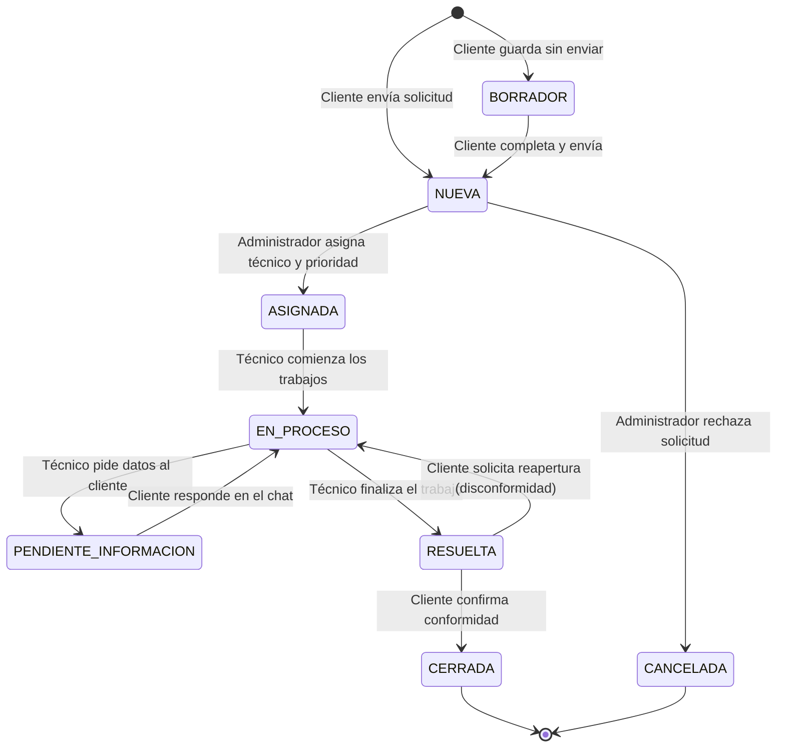
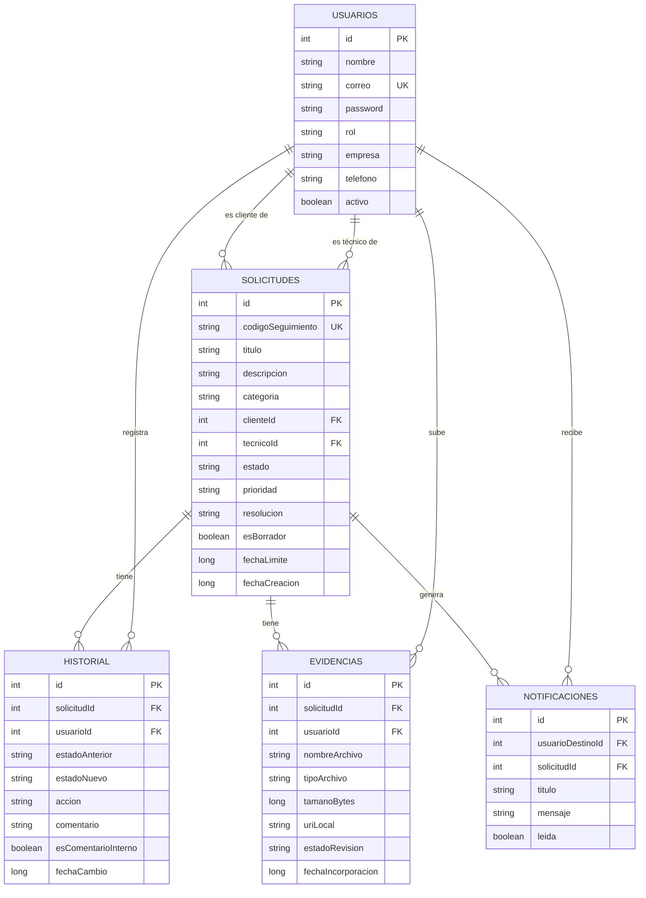

<div align="center">

# 📱 GSM
### Gestión Móvil y Seguimiento de Solicitudes de Clientes

*Una app Android profesional, rápida y limpia que ordena las solicitudes de soporte técnico y servicios que hoy se pierden en WhatsApp.*

[](https://kotlinlang.org/)
[](https://developer.android.com/)
[](https://developer.android.com/jetpack/compose)
[](https://developer.android.com/training/data-storage/room)
[](https://developer.android.com/training/camerax)
[](https://github.com/zxing/zxing)
[](https://developer.android.com/topic/architecture)
[](https://www.duoc.cl/)

[](https://gsm-web-delta.vercel.app/)

**Desarrollado por Elizabeth Reyes y Juan Varas**

<br>

[](https://gsm-web-delta.vercel.app/)

</div>

---

## 📑 Índice

1. [¿De qué trata el proyecto?](#-1-de-qué-trata-el-proyecto)
   - [Plataforma Web y Demo en Vivo](#-plataforma-web-complementaria-y-demo-en-vivo)
2. [Estado del Proyecto (Progreso 100%)](#-2-estado-del-proyecto-progreso-100)
3. [Conceptos básicos explicados fácil (para estudiantes y principiantes)](#-3-conceptos-básicos-explicados-fácil-para-estudiantes-y-principiantes)
4. [Cómo está organizado el código (Estructura de Carpetas)](#-4-cómo-está-organizado-el-código-estructura-de-carpetas)
5. [Cómo viaja la información dentro de la app (Flujo de Datos)](#-5-cómo-viaja-la-información-dentro-de-la-app-flujo-de-datos)
6. [Los 3 roles y lo que puede hacer cada uno (Matriz RBAC)](#-6-los-3-roles-y-lo-que-puede-hacer-cada-uno-matriz-rbac)
7. [Ciclo de vida de una solicitud (Máquina de Estados)](#-7-ciclo-de-vida-de-una-solicitud-máquina-de-estados)
8. [Funcionalidades Principales y Módulos Nativos](#-8-funcionalidades-principales-y-módulos-nativos)
   - [Escáner QR Nativo con CameraX y ML Kit](#-81-escáner-qr-nativo-con-camerax-y-ml-kit)
   - [Billetera de Pases Digitales (Apple Wallet Style)](#-82-billetera-de-pases-digitales-apple-wallet-style)
   - [Adjuntar Evidencias Reales y Persistencia Scoped Storage](#-83-adjuntar-evidencias-reales-y-persistencia-scoped-storage)
   - [Visor de Archivos e Imágenes In-App](#-84-visor-de-archivos-e-imágenes-in-app)
   - [Chat Estilo WhatsApp con Notas Internas Unificadas](#-85-chat-estilo-whatsapp-con-notas-internas-unificadas)
   - [Recuperación de Contraseñas y Edición de Perfil](#-86-recuperación-de-contraseñas-y-edición-de-perfil)
   - [Gestión de Usuarios y Creación de Cuentas por el Administrador](#-87-gestión-de-usuarios-y-creación-de-cuentas-por-el-administrador)
   - [Plataforma Web y Landing de Trazabilidad (Vercel)](#-88-plataforma-web-y-landing-de-trazabilidad-vercel)
9. [Los ViewModels explicados línea por línea](#-9-los-viewmodels-explicados-línea-por-línea)
10. [Datos de prueba (Cuentas y tickets precargados)](#-10-datos-de-prueba-cuentas-y-tickets-precargados)
11. [Seguridad y buenas prácticas aplicadas (OWASP + KISS)](#-11-seguridad-y-buenas-prácticas-aplicadas-owasp--kiss)
12. [Cómo ejecutar el proyecto (Paso a Paso)](#-12-cómo-ejecutar-el-proyecto-paso-a-paso)
13. [Guía para desarrolladores (Cómo agregar nuevas funciones)](#-13-guía-para-desarrolladores-cómo-agregar-nuevas-funciones)
14. [Modelo de Datos Entidad-Relación](#-14-modelo-de-datos-entidad-relación)
15. [Integración con WhatsApp y FileProvider](#-15-integración-con-whatsapp-y-fileprovider)
16. [Checklist Maestro de Criterios del Caso](#-16-checklist-maestro-de-criterios-del-caso)
17. [Preguntas Frecuentes (FAQ)](#-17-preguntas-frecuentes-faq)
18. [Autores](#-18-autores)

---

## 📖 1. ¿De qué trata el proyecto?

### 😩 El problema
Una pyme de servicios informáticos (desarrollo web, soporte técnico, hosting y marketing digital) recibe los requerimientos de sus clientes a través de conversaciones informales de **WhatsApp**. Eso genera un desorden crítico:

| Problema en el día a día | Consecuencia en el negocio |
| :--- | :--- |
| Mensajes mezclados en chats personales y grupales | Las solicitudes **se pierden o se olvidan** |
| No existe un número o código de seguimiento formal | El cliente no sabe el estado de su caso y **reclama** |
| Nadie sabe qué técnico está a cargo | Tareas duplicadas o **abandonadas** |
| No se calculan plazos ni prioridades SLA | Incidentes críticos se atienden tarde |
| No hay registro de cierre ni evidencia | Quedan dudas de si el trabajo se realizó correctamente |

### 💡 La solución: GSM
**GSM (Gestión de Solicitudes Móvil)** es una aplicación Android nativa construida con Jetpack Compose y SQLite (Room) que profesionaliza todo el flujo:

- ✅ **Código Único:** Asigna a cada solicitud un identificador único (ej: `SOL-2026-1001`).
- ✅ **Control por Roles (RBAC):** Separa estrictamente lo que puede hacer un **Cliente**, un **Administrador** y un **Técnico**.
- ✅ **Historial de Auditoría:** Cada cambio de estado, nota y mensaje queda guardado con autor, fecha y hora.
- ✅ **Lector y Generador QR Bidireccional:** Escanea etiquetas físicas con la cámara (CameraX) y genera códigos QR en alta resolución (ZXing) listos para compartir.
- ✅ **Billetera de Pases:** Vista troquelada estilo Apple Wallet para acceso rápido a tickets activos.
- ✅ **Evidencias Reales:** Carga fotos, PDFs y documentos desde el teléfono con persistencia en almacenamiento privado (Scoped Storage).
- ✅ **Notas Internas Privadas:** Administradores y técnicos pueden dejarse notas técnicas que el cliente jamás ve.
- ✅ **100% Offline y Confiable:** Toda la base de datos se almacena localmente en SQLite mediante Room. No requiere internet para funcionar.

> 🎓 **Contexto académico:** Proyecto semestral de la asignatura **DSY1105 - Desarrollo de Aplicaciones Móviles**, Escuela de Informática y Telecomunicaciones, CITT Puente Alto, Duoc UC.

---

### 🌐 Plataforma Web Complementaria y Demo en Vivo

Para complementar la aplicación móvil nativa y permitir a clientes, evaluadores y docentes explorar el ecosistema GSM de forma inmediata desde cualquier navegador (sin necesidad de compilar el APK en Android Studio), se diseñó y desplegó una **plataforma web en producción con Vercel**:

<div align="center">

[](https://gsm-web-delta.vercel.app/)
[](https://gsm-web-delta.vercel.app/)

🔗 **Acceso directo:** [https://gsm-web-delta.vercel.app/](https://gsm-web-delta.vercel.app/)

</div>

#### 🎯 ¿Qué ofrece la plataforma web?
- **Presentación Interactiva:** Exposición visual del problema de solicitudes perdidas en WhatsApp y cómo GSM centraliza la atención.
- **Trazabilidad en Tiempo Real:** Demostración del ciclo de vida y asignación formal mediante códigos únicos (`SOL-2026-100X`).
- **Demostración de Perfiles (RBAC):**
  - 👤 **Cliente:** *Camila Rojas* (Pyme Soluciones Alfa Ltda.)
  - 👑 **Coordinador Administrador:** *Roberto Méndez* (GSM Servicios Digitales)
  - 🔧 **Técnico de Soporte:** *Diego Soto* (Infraestructura y Redes)
- **Diseño Moderno & Responsivo:** Construido con tecnologías web de última generación (React + Vite), paleta de colores profesional y total compatibilidad con teléfonos inteligentes y computadores de escritorio.

---

## 📊 2. Estado del Proyecto (Progreso 100%)

```text
╔══════════════════════════════════════════════════════════════════════════════╗
║                     PROGRESO DEL PROYECTO GSM — 100%                         ║
╠══════════════════════════════════════════════════════════════════════════════╣
║                                                                              ║
║  FASE 1  Base de datos (Entities + DAOs Room)    [██████████] 100%  ✅ LISTO ║
║  FASE 2  Traductores de Dominio (Mappers)        [██████████] 100%  ✅ LISTO ║
║  FASE 3  Repositorios y Reglas de Negocio        [██████████] 100%  ✅ LISTO ║
║  FASE 4  ViewModels + Estado Reactivo            [██████████] 100%  ✅ LISTO ║
║  FASE 5  Pantallas Compose + Apple UI            [██████████] 100%  ✅ LISTO ║
║  FASE 6  Hardware Nativo (CameraX, ZXing, File)  [██████████] 100%  ✅ LISTO ║
║  FASE 7  Seguridad Scoped Storage + FileProvider [██████████] 100%  ✅ LISTO ║
║                                                                              ║
║  ESTADO FINAL: MVP COMPLETO, AUDITADO Y APTO PARA DEFENSA DE TÍTULO / NOTA 7 ║
╚══════════════════════════════════════════════════════════════════════════════╝
```

---

## 🐣 3. Conceptos básicos explicados fácil (para estudiantes y principiantes)

Si eres estudiante o estás aprendiendo Android, estos son los 6 conceptos clave que usa este proyecto explicados en lenguaje simple:

### 1. ¿Qué es Jetpack Compose?
Es la forma moderna que tiene Android para hacer interfaces gráficas usando solo código Kotlin. En vez de escribir archivos `.xml`, escribes funciones marcadas con `@Composable` (como `Text()`, `Button()`, `Row()`, `Column()`). Si una variable cambia, Compose redibuja la pantalla automáticamente.

### 2. ¿Qué es MVVM?
Es una regla para ordenar el código y que no quede todo desordenado en un solo archivo:
* **Model (Modelo):** Los datos puros (un `Usuario`, una `Solicitud`).
* **View (Vista):** Las pantallas y botones (lo que el usuario ve y toca).
* **ViewModel:** El "cerebro intermedio". La pantalla solo le avisa al ViewModel: *"el usuario pulsó el botón Guardar"*; el ViewModel hace los cálculos y actualiza la pantalla.

### 3. ¿Qué es Room y SQLite?
SQLite es una base de datos pequeña que viene dentro de todos los teléfonos Android. Room es una librería oficial de Google que nos permite consultar SQLite usando clases de Kotlin en lugar de escribir consultas SQL complicadas a mano.

### 4. ¿Qué es Scoped Storage y por qué importa?
Desde Android 10+, las aplicaciones no pueden leer libremente cualquier carpeta del teléfono por motivos de privacidad. Cada app tiene una carpeta privada (`context.filesDir`). Si seleccionas una foto con el selector del sistema, Android te da un permiso temporal; para que no se borre al cerrar la app, **copiamos el archivo a nuestra carpeta privada**. Así persiste para siempre.

### 5. ¿Qué es FileProvider?
Es un componente de seguridad de Android. Si quieres compartir un archivo o imagen con otra app (por ejemplo, mandar el código QR a WhatsApp o abrir un PDF en Google Drive), no puedes pasar la ruta directa del disco (`/data/user/...`). El `FileProvider` genera un enlace seguro (`content://...`) con permisos temporales para la app receptora.

### 6. ¿Qué es el principio KISS?
Significa **Keep It Simple, Stupid** (Mantenlo simple y directo). En este proyecto evitamos librerías gigantescas innecesarias, código rebuscado o arquitecturas sobrecargadas. Cada clase se puede leer, entender y defender frente a una comisión evaluadora en 5 minutos.

---

## 📁 4. Cómo está organizado el código (Estructura de Carpetas)

El código se encuentra en `app/src/main/java/com/example/gsm/` organizado por capas:

```text
com/example/gsm/
├── data/                                 # CAPA DE DATOS Y PERSISTENCIA
│   ├── local/                            # SQLite mediante Room
│   │   ├── dao/                          # Consultas SQL (Data Access Objects)
│   │   │   ├── EvidenciaDao.kt           # Consultas para archivos adjuntos
│   │   │   ├── HistorialDao.kt           # Consultas de auditoría y notas internas
│   │   │   ├── NotificacionDao.kt        # Alertas del sistema
│   │   │   ├── SolicitudDao.kt           # Búsquedas, filtros, SLA y borradores
│   │   │   └── UsuarioDao.kt             # Cuentas, roles y contraseñas
│   │   ├── database/
│   │   │   └── GsmDatabase.kt            # Base de datos Room + Datos iniciales de prueba
│   │   └── entity/                       # Tablas de SQLite
│   │       ├── EvidenciaEntity.kt
│   │       ├── HistorialEntity.kt
│   │       ├── NotificacionEntity.kt
│   │       ├── SolicitudEntity.kt
│   │       └── UsuarioEntity.kt
│   ├── mapper/                           # Traductores de Entity (BD) a Model (Dominio)
│   │   ├── HistorialMapper.kt
│   │   ├── SolicitudMapper.kt
│   │   └── UsuarioMapper.kt
│   ├── model/                            # Modelos de negocio y Enums de la app
│   │   ├── CategoriaSolicitud.kt         # INCIDENTE, SOPORTE, DESARROLLO, ETC.
│   │   ├── EstadoSolicitud.kt            # NUEVA, ASIGNADA, EN_PROCESO, RESUELTA, etc.
│   │   ├── Historial.kt                  # Evento de auditoría
│   │   ├── Notificacion.kt               # Alerta al usuario
│   │   ├── PrioridadSolicitud.kt         # BAJA (168h), MEDIA (72h), ALTA (24h), CRITICA (6h)
│   │   ├── RolUsuario.kt                 # CLIENTE, ADMINISTRADOR, TECNICO
│   │   ├── Solicitud.kt                  # Entidad central del ticket
│   │   └── Usuario.kt                    # Cuenta en sesión
│   └── repository/                       # Reglas de negocio y seguridad
│       ├── EvidenciaRepository.kt        # Validación de tipos, tamaños y storage
│       ├── GsmRepository.kt              # Repositorio fachada central
│       ├── HistorialRepository.kt        # Registro de cambios y filtro notas internas
│       ├── NotificacionRepository.kt     # Generación de alertas
│       ├── SolicitudLocalRepository.kt   # Cálculo de SLA y operaciones CRUD
│       ├── UsuarioRepository.kt          # Login, cambio de claves y alta RBAC
│       └── WhatsAppRepository.kt         # Mensajes estructurados para WhatsApp
├── ui/                                   # CAPA DE PRESENTACIÓN (COMPOSE)
│   ├── view/
│   │   ├── components/                   # Componentes visuales reutilizables
│   │   │   ├── EncabezadoPantalla.kt     # Barra superior con botón volver
│   │   │   ├── Formateadores.kt          # Fechas legibles en español
│   │   │   ├── QrNoEncontradoDialog.kt   # Diálogo animado de QR no encontrado
│   │   │   ├── QrScannerModal.kt         # Modal CameraX + ML Kit con analizador en vivo
│   │   │   ├── TarjetaSolicitudItem.kt   # Tarjeta de ticket para listas
│   │   │   └── VisorEvidenciaModal.kt    # Visor in-app de fotos, logs y documentos
│   │   ├── navigation/
│   │   │   └── AppNavigation.kt          # Barra inferior de 5 pestañas y router
│   │   └── screens/                      # Pantallas completas
│   │       ├── admin/
│   │       │   ├── AdminDashboardScreen.kt   # Métricas y contadores SLA
│   │       │   └── GestionUsuariosScreen.kt  # Gestión y alta de cuentas RBAC
│   │       ├── auth/
│   │       │   └── LoginScreen.kt            # Login + Recuperar contraseña + Demo 1-clic
│   │       └── usuario/
│   │           ├── BandejaScreen.kt          # Bandeja de entrada + Filtros + Botón QR
│   │           ├── CrearSolicitudScreen.kt   # Alta de ticket + Adjuntos + Borradores
│   │           ├── DetalleSolicitudScreen.kt # Ficha técnica + Chat WhatsApp + Acciones
│   │           ├── PerfilScreen.kt           # Edición de perfil + Cerrar sesión
│   │           ├── WalletTicketsScreen.kt    # Billetera de Pases Digitales QR
│   │           └── componentes/              # Piezas modulares del ticket
│   │               ├── ChatConversacionTicket.kt # Chat con notas internas
│   │               ├── DetalleUiTokens.kt        # Colores y estilos Apple HIG
│   │               ├── FichaResumenTicket.kt     # Header y datos clave
│   │               ├── TarjetaWalletTicket.kt    # Pase troquelado de evento
│   │               └── TicketCerradoCard.kt      # Banner de ticket finalizado
│   └── viewmodel/                        # Cerebros de estado (MVVM)
│       ├── AdminDashboardViewModel.kt    # Métricas reactivas en tiempo real
│       ├── AuthViewModel.kt              # Sesión, perfil y restablecimiento
│       ├── DetalleSolicitudViewModel.kt  # Conversación, cambios de estado y archivos
│       ├── GsmViewModelFactory.kt        # Inyección de dependencias
│       └── SolicitudViewModel.kt         # Listados, búsqueda y creación
├── util/                                 # UTILITARIOS DEL SISTEMA
│   ├── FileUtil.kt                       # Copia a storage privado, MIME icons y bitmap
│   └── QrCodeUtil.kt                     # Generador de bitmaps QR y compartir WhatsApp
└── MainActivity.kt                       # Punto de entrada de la aplicación Android
```

---

## 🔄 5. Cómo viaja la información dentro de la app (Flujo de Datos)

El flujo de información respeta una dirección estricta y segura:

```text
┌────────────────────────────────────────────────────────────────────────┐
│ 1. PANTALLA (Compose): El usuario toca "Escanear QR" o "Enviar Mensaje"│
└───────────────────────────────────┬────────────────────────────────────┘
                                    │ Notifica el evento al ViewModel
                                    ▼
┌────────────────────────────────────────────────────────────────────────┐
│ 2. VIEWMODEL: Valida los datos y ejecuta una corrutina (viewModelScope) │
└───────────────────────────────────┬────────────────────────────────────┘
                                    │ Invoca la regla de negocio
                                    ▼
┌────────────────────────────────────────────────────────────────────────┐
│ 3. REPOSITORY: Valida el rol con require(...) y verifica la seguridad  │
└───────────────────────────────────┬────────────────────────────────────┘
                                    │ Ejecuta la consulta SQL
                                    ▼
┌────────────────────────────────────────────────────────────────────────┐
│ 4. ROOM DAO: Lee o escribe en SQLite de forma asíncrona                │
└───────────────────────────────────┬────────────────────────────────────┘
                                    │ Devuelve el resultado
                                    ▼
┌────────────────────────────────────────────────────────────────────────┐
│ 5. PANTALLA: Se actualiza sola inmediatamente gracias al estado reactivo│
└────────────────────────────────────────────────────────────────────────┘
```

---

## 👥 6. Los 3 roles y lo que puede hacer cada uno (Matriz RBAC)

La aplicación implementa un control de acceso basado en roles (**RBAC - Role Based Access Control**) estricto tanto a nivel visual como en el repositorio:

| Acción / Funcionalidad | 👤 Cliente | 👔 Administrador | 🔧 Técnico |
| :--- | :---: | :---: | :---: |
| **Crear solicitudes de soporte** | ✅ **SÍ (Único)** | ❌ No | ❌ No |
| **Guardar solicitudes en borrador** | ✅ SÍ | ❌ No | ❌ No |
| **Ver solicitudes** | Solo las suyas | Todas | Solo las asignadas a él |
| **Billetera de Pases QR (Wallet)** | ✅ SÍ | ✅ SÍ | ✅ SÍ |
| **Clasificar categoría y prioridad SLA** | ❌ No | ✅ SÍ | ❌ No |
| **Asignar / Reasignar técnico** | ❌ No | ✅ SÍ | ❌ No |
| **Cancelar solicitud** | ❌ No | ✅ SÍ | ❌ No |
| **Registrar avance técnico en el chat** | ❌ No | ✅ SÍ | ✅ SÍ |
| **Escribir Notas Internas (Ocultas)** | ❌ No | ✅ SÍ | ✅ SÍ |
| **Solicitar información adicional** | ❌ No | ❌ No | ✅ SÍ |
| **Responder información solicitada** | ✅ SÍ | ❌ No | ❌ No |
| **Resolver solicitud** | ❌ No | ❌ No | ✅ SÍ |
| **Confirmar cierre definitivo de ticket**| ✅ SÍ | ❌ No | ❌ No |
| **Solicitar reapertura de ticket** | ✅ SÍ | ❌ No | ❌ No |
| **Ver panel de métricas operativas** | ❌ No | ✅ SÍ | ❌ No |
| **Crear usuarios y asignar roles** | ❌ No | ✅ SÍ | ❌ No |
| **Editar su propio perfil (nombre/tel)** | ✅ SÍ | ✅ SÍ | ✅ SÍ |

---

## 🔁 7. Ciclo de vida de una solicitud (Máquina de Estados)

Cada solicitud transita por estados controlados según la norma del caso:



### ⏱️ Tiempos Límite de Atención (SLA)
El sistema calcula la fecha límite automáticamente según la prioridad fijada por el Administrador:

| Prioridad | Plazo de Resolución Máximo | Color en la App |
| :--- | :--- | :---: |
| **CRITICA** | **6 horas** | 🔴 Rojo Alerta |
| **ALTA** | **24 horas** (1 día) | 🟠 Naranja |
| **MEDIA** | **72 horas** (3 días) | 🔵 Azul |
| **BAJA** | **168 horas** (7 días) | ⚪ Gris Neutro |

---

## 🚀 8. Funcionalidades Principales y Módulos Nativos

### 📷 8.1. Escáner QR Nativo con CameraX y ML Kit
* **Archivo:** [`QrScannerModal.kt`](file:///C:/Users/juanm/OneDrive/Desktop/kotlin/proyectoSemestral/GSM/app/src/main/java/com/example/gsm/ui/view/components/QrScannerModal.kt)
* **Cómo funciona:** Usa la librería oficial de Android Jetpack **CameraX** junto a **Google ML Kit Barcode Scanning**. Analiza los fotogramas en vivo a 30 FPS mediante un hilo de ejecución secundario (`Executors.newSingleThreadExecutor()`).
* **Permisos dinámicos:** Solicita permisos de cámara en caliente usando `ActivityResultContracts.RequestPermission()`.
* **Animación de No Encontrado ([`QrNoEncontradoDialog.kt`](file:///C:/Users/juanm/OneDrive/Desktop/kotlin/proyectoSemestral/GSM/app/src/main/java/com/example/gsm/ui/view/components/QrNoEncontradoDialog.kt)):** Si el código QR escaneado no existe o fue eliminado, despliega un diálogo animado con pulso continuo (`rememberInfiniteTransition`), resaltando el código leído y ofreciendo un botón de *"Reintentar Escaneo"*.
* **Botones para Emulador (1 Clic):** Para evaluar la app en emuladores de PC sin cámara web, incluye botones de prueba directa (`1001`, `1002` y `No Existe ❌`).

---

### 🎟️ 8.2. Billetera de Pases Digitales (Apple Wallet Style)
* **Archivos:** [`WalletTicketsScreen.kt`](file:///C:/Users/juanm/OneDrive/Desktop/kotlin/proyectoSemestral/GSM/app/src/main/java/com/example/gsm/ui/view/screens/usuario/WalletTicketsScreen.kt) y [`TarjetaWalletTicket.kt`](file:///C:/Users/juanm/OneDrive/Desktop/kotlin/proyectoSemestral/GSM/app/src/main/java/com/example/gsm/ui/view/screens/usuario/componentes/TarjetaWalletTicket.kt)
* **Diseño troquelado:** Cada solicitud se dibuja como un pase de evento con muescas semicirculares y línea punteada generada por Canvas (`PathEffect.dashPathEffect`).
* **Generación Offline de QR:** Genera un mapa de bits nítido de 512x512 píxeles mediante el motor de **ZXing** sin consultar internet.
* **Compartir QR por WhatsApp:** El botón *"Compartir"* genera la imagen PNG del código QR y la adjunta a WhatsApp o correo mediante un `FileProvider` seguro (`ACTION_SEND`).

---

### 📎 8.3. Adjuntar Evidencias Reales y Persistencia Scoped Storage
* **Archivo:** [`FileUtil.kt`](file:///C:/Users/juanm/OneDrive/Desktop/kotlin/proyectoSemestral/GSM/app/src/main/java/com/example/gsm/util/FileUtil.kt)
* **Selector Nativo del Sistema:** Emplea `ActivityResultContracts.GetContent()` con filtro universal `*/*`. Acepta cualquier formato (JPG, PNG, WEBP, PDF, TXT, LOG, CSV, XLSX, DOCX, ZIP).
* **Solución de Seguridad Android (Scoped Storage):** Al seleccionar un archivo externo, Android otorga permisos de lectura temporales que expiran al cerrar la aplicación. GSM copia de inmediato los bytes del archivo a su carpeta privada permanente:
  ```text
  context.filesDir/evidencias/evi_{timestamp}_{nombre}
  ```
  De esta forma, **los archivos nunca se pierden**, pueden abrirse incluso tras reiniciar el teléfono y funcionan 100% offline.
* **Límite de Tamaño:** Configurado en **15 MB** por archivo con formateo automático (`KB` / `MB`).

---

### 👁️ 8.4. Visor de Archivos e Imágenes In-App
* **Archivo:** [`VisorEvidenciaModal.kt`](file:///C:/Users/juanm/OneDrive/Desktop/kotlin/proyectoSemestral/GSM/app/src/main/java/com/example/gsm/ui/view/components/VisorEvidenciaModal.kt)
* Permite inspeccionar evidencias sin necesidad de abandonar la aplicación:
  - **Imágenes:** Decodifica y renderiza el archivo en pantalla usando `BitmapFactory.decodeFile()` y `asImageBitmap()`.
  - **Logs y Archivos de Texto:** Abre una caja de visualización con tipografía monospace estilo terminal para leer reportes de errores.
  - **Documentos (PDF, Office):** Muestra ficha técnica con peso y fecha, e incorpora el botón **"Abrir con App Externa"** que usa `FileProvider` para enviarlo a visores del sistema con permisos seguros.

---

### 💬 8.5. Chat Estilo WhatsApp con Notas Internas Unificadas
* **Archivo:** [`ChatConversacionTicket.kt`](file:///C:/Users/juanm/OneDrive/Desktop/kotlin/proyectoSemestral/GSM/app/src/main/java/com/example/gsm/ui/view/screens/usuario/componentes/ChatConversacionTicket.kt)
* **Burbujas Conversacionales:** Verde suave a la derecha para mensajes propios con doble check (`✓✓`) y blanco a la izquierda para mensajes recibidos con badge de autor.
* **Interruptor de Nota Interna:** Ubicado directamente sobre la caja de redacción del mensaje.
  - Si el **Administrador** o el **Técnico** activan el interruptor: la caja se ilumina en color ámbar (`#FFF8E1`), el ícono cambia a candado cerrado y el comentario se guarda como nota interna (`esComentarioInterno = 1`).
  - **Privacidad Garantizada:** La base de datos Room (`HistorialDao`) filtra automáticamente las notas internas para que **el Cliente nunca las reciba ni las visualice**.

---

### 🔐 8.6. Recuperación de Contraseñas y Edición de Perfil
* **Login ([`LoginScreen.kt`](file:///C:/Users/juanm/OneDrive/Desktop/kotlin/proyectoSemestral/GSM/app/src/main/java/com/example/gsm/ui/view/screens/auth/LoginScreen.kt)):** Diálogo modal de restablecimiento directo donde el usuario ingresa su correo y su nueva clave con validación de coincidencia y guardado inmediato en SQLite.
* **Perfil ([`PerfilScreen.kt`](file:///C:/Users/juanm/OneDrive/Desktop/kotlin/proyectoSemestral/GSM/app/src/main/java/com/example/gsm/ui/view/screens/usuario/PerfilScreen.kt)):** Permite editar el nombre completo, teléfono y empresa con actualización reactiva instantánea en la sesión activa y persistencia en Room.

---

### 👑 8.7. Gestión de Usuarios y Creación de Cuentas por el Administrador
* **Archivo:** [`GestionUsuariosScreen.kt`](file:///C:/Users/juanm/OneDrive/Desktop/kotlin/proyectoSemestral/GSM/app/src/main/java/com/example/gsm/ui/view/screens/admin/GestionUsuariosScreen.kt)
* **Pantalla Dedicada:** Accesible desde el perfil del Administrador y desde el panel de Métricas.
* **Tarjetas Resumen:** Muestra contadores rápidos de usuarios registrados por rol (Clientes, Técnicos, Administradores).
* **Alta de Usuarios con Chips:** Formulario modal para crear cuentas con validación de correo único, contraseña y selector de rol RBAC mediante `FilterChip`.

---

### 🌐 8.8. Plataforma Web y Landing de Trazabilidad (Vercel)
* **Enlace Oficial:** [`https://gsm-web-delta.vercel.app/`](https://gsm-web-delta.vercel.app/)
* **Hosting e Infraestructura:** Desplegado de forma continua en **Vercel** con certificado SSL / HTTPS activo.
* **Integración al Ecosistema:** Funciona como portal público de divulgación y presentación para pymes y empresas de servicios TI. Permite a cualquier evaluador o cliente comprender la matriz de roles, la generación de pases digitales y el flujo de resolución de solicitudes antes de instalar la app nativa en su teléfono Android.

---

## 🧠 9. Los ViewModels explicados línea por línea

Los ViewModels almacenan el estado en variables observables de Compose (`mutableStateOf`). Al cambiar su valor, la pantalla se redibuja sola:

### 1. `AuthViewModel.kt` (Sesión y Usuarios)
* `usuarioActual`: Usuario que tiene la sesión abierta (o `null` si está en el login).
* `iniciarSesion(correo, password)`: Busca la cuenta en SQLite y verifica la contraseña.
* `recuperarPassword(correo, nuevaPassword)`: Actualiza la clave del usuario en la base de datos.
* `actualizarPerfil(nombre, telefono, empresa)`: Guarda los nuevos datos de contacto en SQLite.
* `iniciarSesionDemo(rol)`: Acceso rápido de 1 clic para evaluaciones y pruebas.

### 2. `SolicitudViewModel.kt` (Bandeja y Búsquedas)
* `listaSolicitudes`: Listado reactivo de tickets que se muestran en la bandeja.
* `textoBusqueda`: Filtro por texto en tiempo real.
* `estadoFiltro`: Filtro por estado (`TODOS`, `NUEVA`, `EN_PROCESO`, etc.).
* `soloAtrasadas`: Filtro booleano para mostrar únicamente tickets que superaron su SLA.
* `buscarPorQr(codigo, alEncontrar, alFallar)`: Busca el ticket en SQLite a partir del string leído por CameraX; si no existe, ejecuta `alFallar` para disparar el diálogo animado.
* `crearSolicitud(...)`: Inserta una nueva solicitud (o borrador) vinculando evidencias persistidas.

### 3. `DetalleSolicitudViewModel.kt` (Detalle del Ticket y Chat)
* `solicitud`: Ticket cargado en pantalla con sus datos en vivo.
* `historial`: Lista de eventos de auditoría y mensajes del chat.
* `evidencias`: Archivos adjuntos al ticket.
* `tecnicosDisponibles`: Lista de técnicos para asignación por el Administrador.
* `clasificarYPriorizar(...)`, `asignarTecnico(...)`, `registrarAvance(...)`, `confirmarCierre(...)`: Métodos con validación de permisos RBAC.

### 4. `AdminDashboardViewModel.kt` (Métricas Operativas)
* `totalRecibidas`, `totalEnProceso`, `totalAtrasadas`, `totalPorTecnico`: Métricas calculadas en tiempo real a través de `Flow` de Room.

---

## 🧪 10. Datos de prueba (Cuentas y tickets precargados)

Al instalar la app por primera vez, `GsmDatabase` inicializa automáticamente datos de prueba realistas:

### 🔑 Cuentas precargadas (Contraseña de todas: `1234`)

| Rol | Correo | Nombre de Prueba | Empresa ficticia |
| :--- | :--- | :--- | :--- |
| 👤 **Cliente** | `cliente@pyme.cl` | Camila Rojas | Logística Express SpA |
| 👔 **Administrador** | `admin@gsm.cl` | Roberto Méndez | GSM Soporte Central |
| 🔧 **Técnico** | `tecnico1@gsm.cl` | Diego Soto | Área de Infraestructura |
| 🔧 **Técnico** | `tecnico2@gsm.cl` | Valentina Pino | Área de Desarrollo Web |

### 📋 Solicitudes de prueba

| Código | Título | Estado Inicial | Objetivo de Prueba |
| :--- | :--- | :--- | :--- |
| `SOL-2026-1001` | Error 500 al subir catálogo | 🔵 NUEVA | Probar clasificación y asignación por Admin |
| `SOL-2026-1002` | Caída del correo corporativo | 🔴 EN PROCESO | Demostrar alerta de ticket atrasado (SLA vencido) |
| `SOL-2026-1003` | Banner de campaña de invierno | 🟡 PENDIENTE INFO | Demostrar respuesta del cliente en el chat |
| `SOL-2026-1004` | Subdominio para pruebas QA | 🟢 RESUELTA | Probar confirmación de cierre o reapertura |

---

## 🛡️ 11. Seguridad y buenas prácticas aplicadas (OWASP + KISS)

| Principio de Seguridad | Cómo lo implementa GSM | Ubicación en el Código |
| :--- | :--- | :--- |
| **Control de Acceso Roto (OWASP M1)** | Cada método valida el rol con `require(usuario.rol == ...)` antes de tocar la base de datos | `GsmRepository.kt` |
| **Aislamiento de Clientes** | Un cliente solo puede consultar solicitudes donde `solicitud.clienteId == cliente.id` | `SolicitudDao.kt` |
| **Privacidad de Notas Internas** | Si el rol es `CLIENTE`, SQLite excluye registros con `esComentarioInterno = 1` | `HistorialDao.kt` |
| **Permisos de Archivos Seguros** | Uso de `FileProvider` sin exponer rutas físicas absolutas del teléfono | `AndroidManifest.xml` |
| **Almacenamiento Confiable** | Archivos copiados a `filesDir` privado sin depender de permisos temporales revocables | `FileUtil.kt` |
| **Validación de Entradas** | Sanitización y comprobación de cadenas no vacías en títulos y comentarios | `UsuarioRepository.kt` |

---

## 💻 12. Cómo ejecutar el proyecto (Paso a Paso)

### Requisitos Previos
* **Android Studio:** Ladybug (2024.2) o superior.
* **Java Development Kit (JDK):** JDK 17 o JDK 21 (incluido en Android Studio en `jbr/`).
* **Dispositivo / Emulador:** Android 13.0 (API 33) hasta Android 15.0 (API 35).

### Pasos de Instalación
1. **Clonar el repositorio:**
   ```bash
   git clone https://github.com/usuario/GSM.git
   ```
2. **Abrir en Android Studio:** Selecciona la carpeta `GSM` y espera que Gradle sincronice las dependencias.
3. **Compilar desde Terminal (Opcional):**
   ```bash
   ./gradlew assembleDebug
   ```
4. **Ejecutar:** Presiona el botón verde **▶️ Run** en Android Studio seleccionando tu emulador o teléfono físico.

---

## 🛠️ 13. Guía para desarrolladores (Cómo agregar nuevas funciones)

Si eres un desarrollador nuevo en el equipo, sigue esta receta de 5 pasos para agregar una nueva funcionalidad:

```text
1. DATA (Entity & DAO)      → Modifica la tabla en data/local/entity/ y la consulta en data/local/dao/
2. MAPPER                   → Actualiza el traductor en data/mapper/
3. REPOSITORY               → Agrega la función de negocio en data/repository/ validando el rol con require()
4. VIEWMODEL                → Conecta la función en ui/viewmodel/ actualizando el estado reactivo
5. PANTALLA (Compose)       → Diseña el botón o campo en ui/view/screens/ usando componentes existentes
```

---

## 💾 14. Modelo de Datos Entidad-Relación



---

## 📲 15. Integración con WhatsApp y FileProvider

La aplicación genera mensajes preformateados listos para ser compartidos a través de un `Intent` nativo de Android (`ACTION_SEND`):

```text
🎫 *PASE DIGITAL GSM*
📌 Ticket: SOL-2026-1001
📝 Título: Error 500 al subir catálogo
🏷️ Categoría: INCIDENTE
⚡ Prioridad: ALTA
📊 Estado: ASIGNADA
🔗 Seguimiento: https://gsm-soporte.cl/seguimiento/SOL-2026-1001
```

Junto con el texto, adjunta automáticamente la imagen PNG del código QR generado en el almacenamiento en caché mediante el `FileProvider` con la bandera `FLAG_GRANT_READ_URI_PERMISSION`.

---

## ✅ 16. Checklist Maestro de Criterios del Caso

| Criterio Evaluado | Detalle del Requerimiento | Estado |
| :--- | :--- | :---: |
| **01 – 06** | Creación de ticket con código único (`SOL-YYYY-XXXX`), fecha, cliente y estado `NUEVA` | 🟢 100% |
| **07 – 08** | Mensaje para WhatsApp con código, enlace de seguimiento y QR | 🟢 100% |
| **09 – 11** | Consulta de estado, última actualización e historial de auditoría completo | 🟢 100% |
| **12 – 16** | Clasificación, cálculo automático de SLA, asignación y reasignación de técnicos | 🟢 100% |
| **17 – 21** | Bandeja del técnico asignado, registro de avances y notas internas | 🟢 100% |
| **22 – 27** | Estado pendiente de información, detección de atrasos y filtros reactivos | 🟢 100% |
| **28 – 30** | Bandeja de notificaciones y panel de métricas operativas del Administrador | 🟢 100% |
| **31 – 34** | Registro de solución, confirmación de conformidad, reapertura y cierre | 🟢 100% |
| **35 – 40** | Almacenamiento local SQLite (Room), control RBAC estricto y datos ficticios | 🟢 100% |
| **Nativo 1** | Lector QR en vivo con CameraX y Google ML Kit con animación de no encontrado | 🟢 100% |
| **Nativo 2** | Billetera de Pases Digitales QR con estética Apple Wallet y compartir WhatsApp | 🟢 100% |
| **Nativo 3** | Adjuntar evidencia real desde el dispositivo con Scoped Storage permanente | 🟢 100% |
| **Nativo 4** | Visor in-app de evidencias (fotos, logs, documentos) y apertura con FileProvider | 🟢 100% |
| **Nativo 5** | Restablecimiento de contraseña y edición de perfil de usuario en SQLite | 🟢 100% |
| **Nativo 6** | Pantalla independiente de gestión y creación de usuarios por el Administrador | 🟢 100% |
| **Nativo 7** | Íconos vectoriales oficiales de Google (`material-icons-extended`) | 🟢 100% |

---

## ❓ 17. Preguntas Frecuentes (FAQ)

<details>
<summary><b>1. ¿Por qué las evidencias no se borran al cerrar la app?</b></summary>

Porque no usamos URIs temporales del selector de archivos. En `FileUtil.kt`, en cuanto el usuario selecciona un archivo, el sistema copia inmediatamente sus bytes al almacenamiento privado interno de la aplicación (`context.filesDir/evidencias/`). Esta carpeta pertenece a la app y nunca caduca.
</details>

<details>
<summary><b>2. ¿Cómo funciona el escáner de códigos QR si estoy en un emulador de PC sin cámara?</b></summary>

En `QrScannerModal.kt` implementamos botones de prueba rápida de 1 clic (`1001`, `1002` y `No Existe ❌`). Al pulsar cualquiera de ellos, se simula la captura del rótulo QR instantáneamente, permitiendo demostrar tanto la apertura del ticket como el diálogo animado de error.
</details>

<details>
<summary><b>3. ¿Por qué el técnico y el administrador no pueden crear tickets?</b></summary>

Por diseño de la matriz de roles (RBAC). El ticket de soporte representa la necesidad de un cliente que contrató un servicio. Si un técnico o administrador pudiera crearse tickets a sí mismo como cliente, se rompería la integridad de los tiempos de respuesta (SLA) y las métricas operativas.
</details>

<details>
<summary><b>4. ¿Por qué las notas internas están ocultas para el cliente?</b></summary>

Porque están diseñadas para comentarios técnicos y diagnósticos privados del equipo (ej: *"El cliente no tiene actualizado su plugin de WordPress"* o *"Revisar credenciales de base de datos"*). La base de datos Room (`HistorialDao`) las filtra a nivel de consulta SQL (`WHERE esComentarioInterno = 0`) para que nunca viajen a la pantalla del cliente.
</details>

<details>
<summary><b>5. ¿Por qué se utilizó 'material-icons-extended'?</b></summary>

Para garantizar una estética nativa y sobria alineada con las guías de diseño de Android (Material 3). Aunque en modo Debug incluye el catálogo completo, durante la compilación en Release la herramienta R8/ProGuard realiza *tree-shaking*, eliminando todos los íconos no utilizados y dejando el APK con un peso óptimo.
</details>

---

## 👩‍💻👨‍💻 18. Autores

<div align="center">

| | Nombre | Rol en el Proyecto |
| :---: | :--- | :--- |
| 👩‍💻 | **Elizabeth Reyes** | Desarrolladora Android |
| 👨‍💻 | **Juan Varas** | Desarrollador Android |

**Asignatura:** DSY1105 - Desarrollo de Aplicaciones Móviles  
**Institución:** Duoc UC · Sede Puente Alto · CITT  
**Semestre:** 2026-2  

---

*Desarrollado con dedicación en Kotlin y Jetpack Compose bajo el principio KISS.*

</div>
