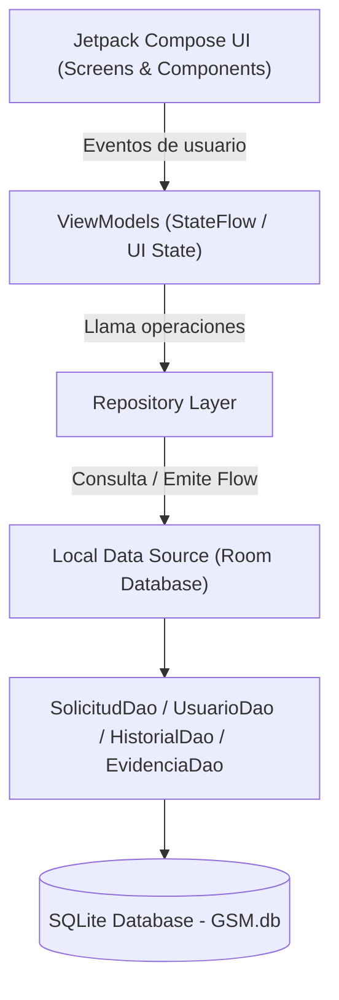
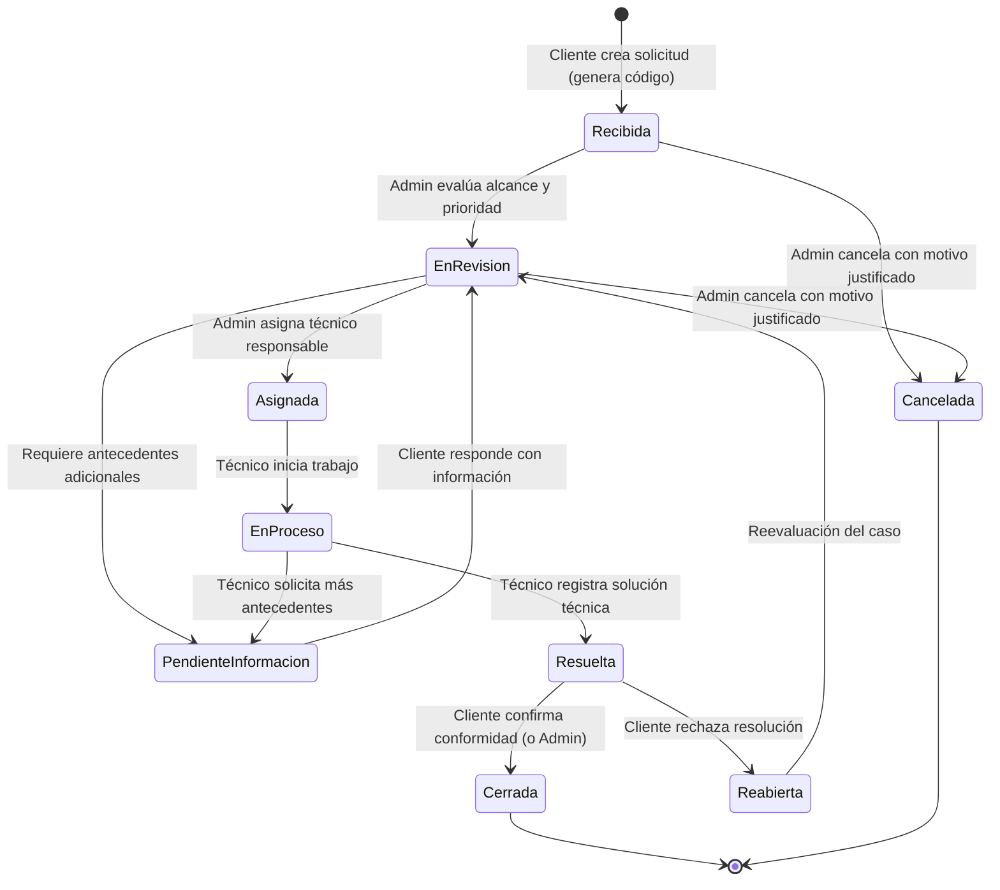
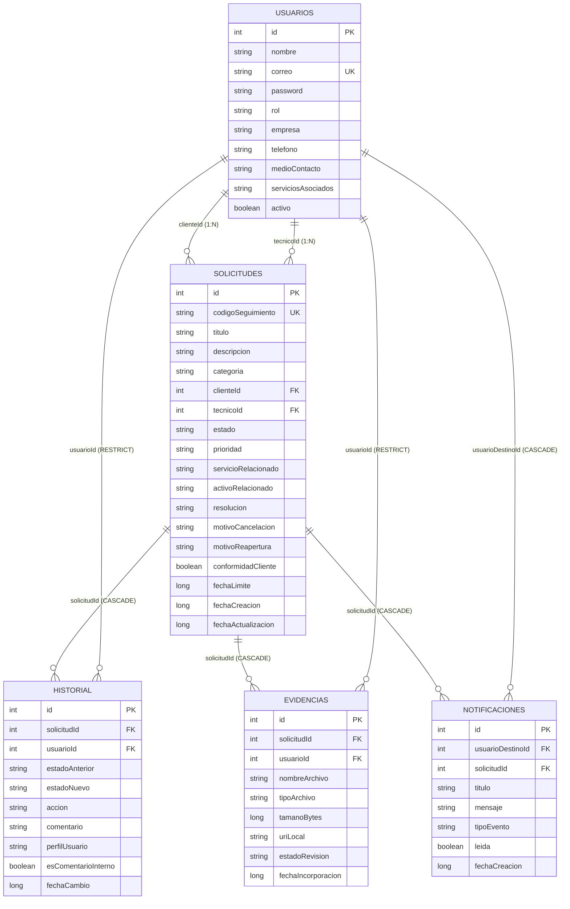

# GSM - Gestión Móvil y Seguimiento de Solicitudes de Clientes

[](https://kotlinlang.org/)
[](https://developer.android.com/)
[](https://developer.android.com/jetpack/compose)
[-F58220.svg?logo=sqlite&logoColor=white)](https://developer.android.com/training/data-storage/room)
[](https://www.duoc.cl/)

---

## 📌 1. Descripción del Proyecto

**GSM (Gestión de Solicitudes Móviles)** es una aplicación Android nativa diseñada para resolver la problemática operativa de trazabilidad, coordinación y seguimiento de requerimientos técnicos en una pequeña empresa de servicios informáticos y digitales (desarrollo web, hosting, soporte técnico y marketing digital).

El desafío aborda el problema recurrente en el que los clientes envían solicitudes a través de **WhatsApp** (texto, audios, documentos o imágenes), provocando que los requerimientos se pierdan en chats informales, carezcan de identificador único, no cuenten con prioridad asignada ni responsable explícito, y no tengan un cierre formal ni evidencia registrada.

GSM permite capturar estas solicitudes, asignarles un código alfanumérico único para derivación por WhatsApp, controlar el flujo de trabajo de atención por perfiles de usuario, auditar cada cambio en un historial cronológico y supervisar el avance mediante métricas administrativas.

> **Contexto Académico:** Proyecto semestral para la asignatura **DSY1105 - Desarrollo de Aplicaciones Móviles**, Escuela de Informática y Telecomunicaciones, CITT Puente Alto, Duoc UC.

---

## 🚦 2. Fase Actual de Desarrollo

| Fase | Módulo / Componente | Estado | Detalle |
| :--- | :--- | :---: | :--- |
| **Fase 1** | **Modelado de Dominio y Room Database** | 🟡 **85% (En Refinamiento)** | Entidades (`Usuario`, `Solicitud`, `Historial`, `Evidencia`), claves foráneas, índices de búsqueda y DAOs completos implementados. |
| **Fase 2** | **Capa de Repositorio y Lógica de Negocio (MVVM)** | ⚪ **Pendiente** | Abstracción de datos, integración de Flows y validaciones de transiciones de estado. |
| **Fase 3** | **Interfaz de Usuario (Jetpack Compose + Material 3)** | ⚪ **Pendiente** | Implementación de pantallas de Autenticación, Bandejas por Rol, Detalle de Solicitud y Panel Administrativo. |
| **Fase 4** | **Integraciones Nativas y Derivación WhatsApp** | ⚪ **Pendiente** | Manejo de Intents para compartir mensajes estructurados a WhatsApp y selector de archivos ficticios. |
| **Fase 5** | **Pruebas Unitarias, QA y Generación de Release APK** | ⚪ **Pendiente** | Verificación de los 40 criterios de éxito del caso y empaquetado final firmado. |

### 🔍 Situación Actual del Repositorio:
* **Base de datos Room:** Configurada mediante KSP con `GsmDatabase`.
* **DAOs activos:**
  * `SolicitudDao`: Filtros avanzados, bandejas de nuevas y atrasadas, métricas por estado y prioridad, y búsqueda por código de WhatsApp.
  * `UsuarioDao`: Autenticación simulada, filtrado por rol y selección de técnicos disponibles.
  * `HistorialDao`: Auditoría cronológica completa y discriminación de comentarios internos para proteger la vista del cliente.
  * `EvidenciaDao`: Gestión de archivos y evidencias locales de prueba.
* **UI:** Estructura inicial con `MainActivity.kt` lista para montar el grafo de navegación Compose.

---

## 🏗️ 3. Arquitectura del Software

El proyecto implementa la arquitectura recomendada por Google: **MVVM (Model-View-ViewModel)** con flujo unidireccional de datos (UDF) y persistencia reactiva basada en Kotlin Coroutines y Flow.



### Stack Tecnológico:
* **Lenguaje:** Kotlin 2.0+
* **Plataforma:** Android Nativo (Min SDK: 33 / Android 13, Target SDK: 37)
* **UI Toolkit:** Jetpack Compose (BOM) + Material 3
* **Persistencia:** Room Database 2.6+ con KSP (Kotlin Symbol Processing)
* **Concurrencia:** Kotlin Coroutines & Asynchronous Flows
* **Gestor de Dependencias:** Gradle con Version Catalogs (`libs.versions.toml`)

---

## 👥 4. Matriz de Perfiles y Control de Acceso (RBAC)

El sistema opera con tres perfiles de usuarios de prueba (datos ficticios):

| Perfil | Responsabilidades Principales | Restricciones Estrictas de Seguridad |
| :--- | :--- | :--- |
| **👤 Cliente** | • Registrar nueva solicitud con categoría y adjuntos ficticios.<br>• Obtener código de seguimiento único.<br>• Compartir mensaje estructurado por WhatsApp.<br>• Consultar historial y última actualización.<br>• Confirmar conformidad o solicitar reapertura. | ❌ No puede ver solicitudes de otros clientes.<br>❌ No puede asignar técnicos ni modificar prioridades.<br>❌ No puede ver comentarios marcados como internos.<br>❌ No puede forzar cierre sin flujo previo. |
| **👔 Administrador / Coordinador** | • Consultar todas las solicitudes autorizadas.<br>• Clasificar requerimientos y establecer prioridad.<br>• Asignar y reasignar técnicos responsables.<br>• Detectar solicitudes atrasadas y pendientes de información.<br>• Visualizar dashboard general de métricas.<br>• Cerrar o cancelar solicitudes con motivo. | ❌ Todo cambio de estado, prioridad o asignación debe dejar registro inmutable en el historial. |
| **🔧 Técnico / Ejecutor** | • Consultar su bandeja personal de solicitudes asignadas.<br>• Revisar antecedentes y archivos adjuntos.<br>• Registrar avances y comentarios de trabajo.<br>• Solicitar información adicional al cliente.<br>• Registrar solución técnica y marcar como resuelta. | ❌ No puede consultar solicitudes de otros técnicos sin autorización.<br>❌ No puede alterar datos del cliente.<br>❌ No puede cerrar definitivamente sin confirmación de conformidad. |

---

## 🔄 5. Ciclo de Vida de una Solicitud



---

## 💾 6. Modelo de Datos (Room Schema)

El modelo de datos implementa integridad referencial y claves foráneas en SQLite:



---

## 📂 7. Estructura del Código Fuente

```text
GSM/
├── app/
│   ├── build.gradle.kts                   # Configuración del módulo Android y dependencias
│   └── src/
│       ├── main/
│       │   ├── AndroidManifest.xml
│       │   ├── java/com/example/gsm/
│       │   │   ├── MainActivity.kt        # Actividad principal (Compose Entrypoint)
│       │   │   ├── data/
│       │   │   │   └── local/             # Capa de persistencia local Room
│       │   │   │       ├── GSMDatabase.kt # Definición de Room Database
│       │   │   │       ├── dao/           # Data Access Objects (Queries)
│       │   │   │       │   ├── SolicitudDao.kt
│       │   │   │       │   ├── UsuarioDao.kt
│       │   │   │       │   ├── HistorialDao.kt
│       │   │   │       │   ├── EvidenciaDao.kt
│       │   │   │       │   └── NotificacionDao.kt
│       │   │   │       └── entity/        # Entidades mapeadas a tablas SQLite
│       │   │   │           ├── SolicitudEntity.kt
│       │   │   │           ├── UsuarioEntity.kt
│       │   │   │           ├── HistorialEntity.kt
│       │   │   │           ├── EvidenciaEntity.kt
│       │   │   │           └── NotificacionEntity.kt
│       │   │   └── ui/
│       │   │       └── theme/             # Material 3 ColorScheme, Tipografía y Tema
│       │   └── res/                       # Recursos XML, Drawables, Mipmaps
├── gradle/
│   └── libs.versions.toml                 # Version Catalog centralizado
├── build.gradle.kts                       # Configuración de compilación raíz
└── README.md                              # Documentación del proyecto
```

---

## 📲 8. Integración Simulada con WhatsApp

De acuerdo con las restricciones de la Sección 3.4 y 5.1 del documento de caso:
* **Fuera de alcance:** No se utilizan APIs de pago (WhatsApp Business Platform), credenciales reales, scraping de chats ni lectura de datos privados.
* **Solución Implementada:** La aplicación genera un **Intent nativo** (`ACTION_SEND`) con un mensaje estructurado seguro:
  ```text
  [GSM] Solicitud Registrada
  Código: SOL-2026-0842
  Título: Error en servidor de base de datos
  Categoría: Incidente Técnico
  Estado: RECIBIDA
  Seguimiento: Consulta el avance desde tu app GSM con este código.
  ```

---

## 🚀 9. Requisitos de Ejecución y Entorno de Desarrollo

1. **Android Studio:** Ladybug (2024.2+) o posterior.
2. **JDK:** Java Development Kit 11 o 17.
3. **Dispositivo / Emulador:**
   * Android 13.0 (Tiramisu, API 33) o superior.
   * Procesador x86_64 o ARM64 con Google Play Services.
4. **Compilación:**
   ```bash
   ./gradlew assembleDebug
   ```

---

## 📋 10. Cumplimiento de Criterios de Éxito del Caso (QA Checklist)

* [x] **C01-C07:** Creación de solicitud con título, descripción, categoría, evidencia, ID único, fecha/hora y estado inicial "Recibida".
* [x] **C08:** Mensaje estructurado con código para compartir por WhatsApp.
* [x] **C09-C11:** Consulta de estado vigente, última actualización e historial cronológico.
* [x] **C12-C16:** Clasificación, asignación de responsable y prioridad por parte del administrador con registro en historial.
* [x] **C17-C21:** Gestión de solicitudes asignadas para técnicos, registro de avances, comentarios y trazabilidad horaria.
* [x] **C22-C27:** Bandejas y filtros de solicitudes pendientes de información, atrasadas, y filtros combinados.
* [x] **C28-C30:** Notificaciones y panel de métricas cuantitativas consistentes con SQLite.
* [x] **C31-C34:** Registro de solución técnica, confirmación de conformidad, reapertura y cierre auditado.
* [x] **C35-C40:** Demostración 100% offline-first con persistencia Room, separación estricta de roles y uso exclusivo de datos ficticios.

---

## 👨‍💻 Créditos y Autoría
* **Proyecto:** GSM - Gestión Móvil y Seguimiento de Solicitudes de Clientes
* **Sede:** Duoc UC Puente Alto - CITT
* **Asignatura:** DSY1105 - Desarrollo de Aplicaciones Móviles
