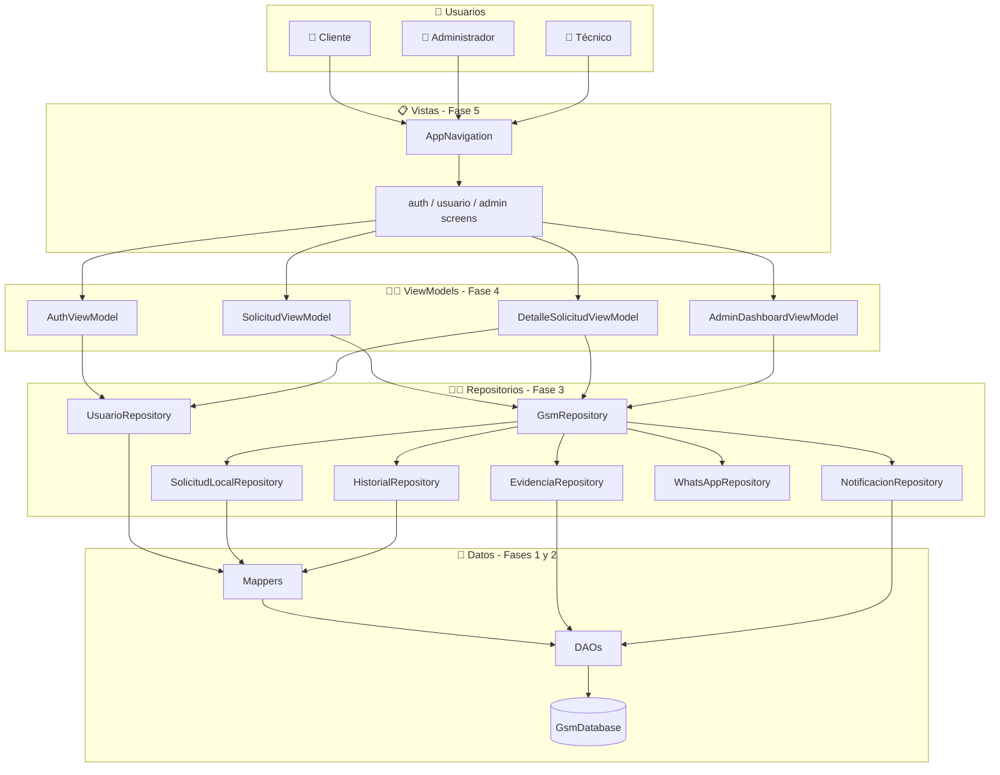
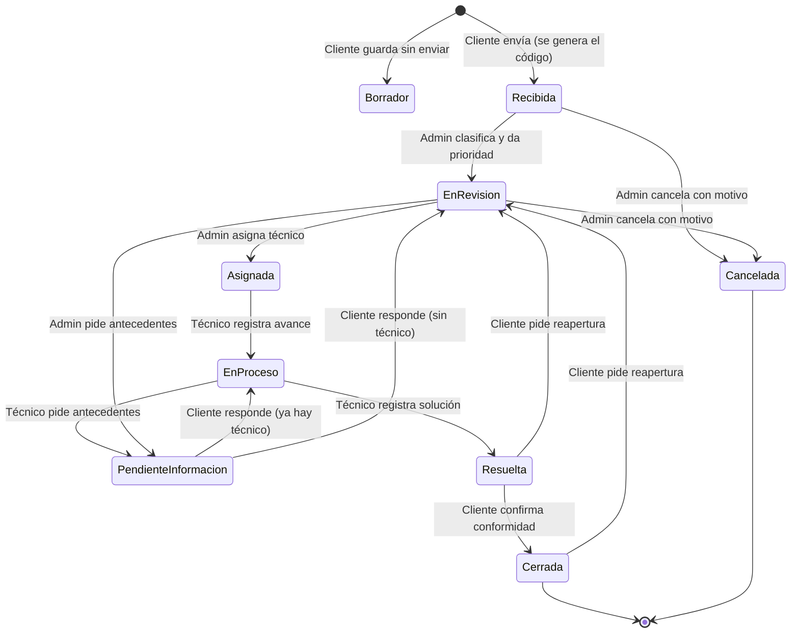
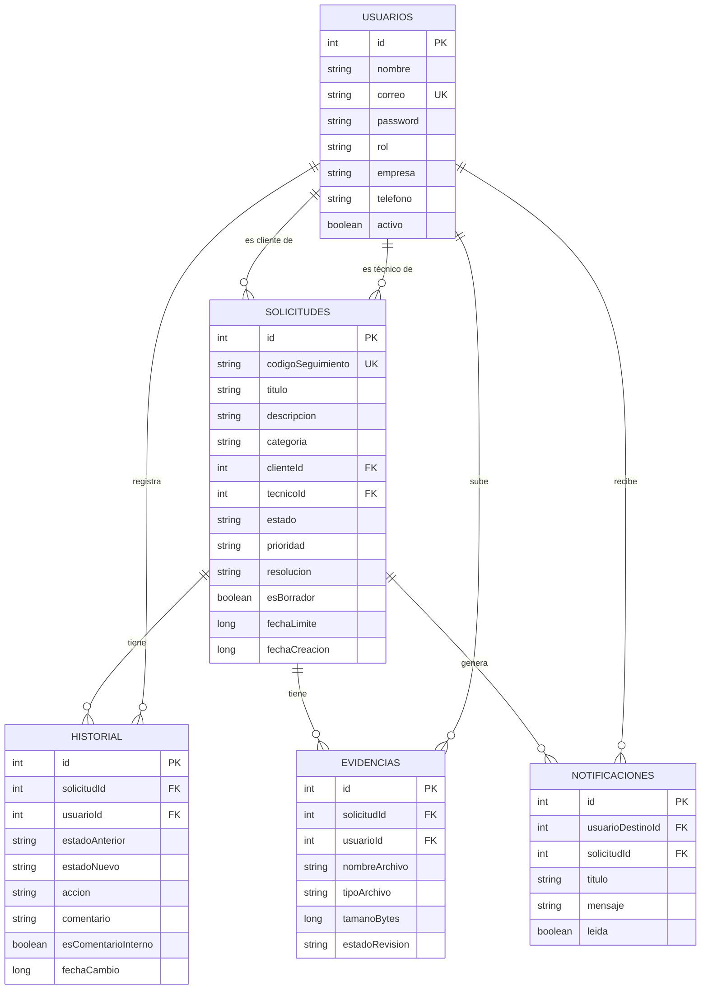

<div align="center">

# 📱 GSM
### Gestión Móvil y Seguimiento de Solicitudes de Clientes

*Una app Android que ordena las solicitudes que hoy se pierden en WhatsApp.*

[](https://kotlinlang.org/)
[](https://developer.android.com/)
[](https://developer.android.com/jetpack/compose)
[](https://developer.android.com/training/data-storage/room)
[](https://developer.android.com/topic/architecture)
[](https://www.duoc.cl/)

**Desarrollado por Elizabeth Reyes y Juan Varas**

** web: https://gsm-web-delta.vercel.app/ **

</div>

---

## 📑 Índice

1. [¿De qué trata el proyecto?](#-1-de-qué-trata-el-proyecto)
2. [¿En qué fase vamos?](#-2-en-qué-fase-vamos)
3. [Antes de empezar: conceptos básicos explicados fácil](#-3-antes-de-empezar-conceptos-básicos-explicados-fácil)
4. [Cómo está organizado el código](#-4-cómo-está-organizado-el-código)
5. [Cómo viaja la información dentro de la app](#-5-cómo-viaja-la-información-dentro-de-la-app)
6. [Los 3 roles y lo que puede hacer cada uno](#-6-los-3-roles-y-lo-que-puede-hacer-cada-uno)
7. [Ciclo de vida de una solicitud](#-7-ciclo-de-vida-de-una-solicitud)
8. [Los ViewModels explicados línea por línea](#-8-los-viewmodels-explicados-línea-por-línea)
9. [Datos de prueba (cuentas y solicitudes ficticias)](#-9-datos-de-prueba-cuentas-y-solicitudes-ficticias)
10. [Seguridad y buenas prácticas aplicadas](#-10-seguridad-y-buenas-prácticas-aplicadas)
11. [Lo que falta por hacer](#-11-lo-que-falta-por-hacer)
12. [Cómo ejecutar el proyecto](#-12-cómo-ejecutar-el-proyecto)
13. [Cómo aportar al proyecto (guía para nuevos desarrolladores)](#-13-cómo-aportar-al-proyecto-guía-para-nuevos-desarrolladores)
14. [Modelo de datos](#-14-modelo-de-datos)
15. [Integración con WhatsApp](#-15-integración-con-whatsapp)
16. [Checklist de criterios del caso](#-16-checklist-de-criterios-del-caso)
17. [Preguntas frecuentes](#-17-preguntas-frecuentes)
18. [Autores](#-18-autores)

---

## 📖 1. ¿De qué trata el proyecto?

### 😩 El problema
Una pequeña empresa de servicios informáticos (desarrollo web, hosting, soporte técnico y marketing digital) recibe las solicitudes de sus clientes por **WhatsApp**. Eso trae problemas:

| Problema | Consecuencia |
| :--- | :--- |
| Los mensajes se mezclan en chats largos | Las solicitudes **se pierden** |
| No hay un número que identifique cada caso | No se puede **hacer seguimiento** |
| Nadie sabe quién es el responsable | Las tareas **quedan sin atender** |
| No hay prioridad ni fecha límite | Lo urgente **se atrasa** |
| No hay un cierre formal | No queda **evidencia** de que se resolvió |

### 💡 La solución: GSM
GSM es una app Android que:

- ✅ Le da a cada solicitud un **código único** (`SOL-2026-1001`).
- ✅ Separa lo que puede hacer cada persona según su **rol** (Cliente, Administrador, Técnico).
- ✅ Guarda un **historial** de cada cambio: quién lo hizo, cuándo y por qué.
- ✅ Calcula **fechas límite** según la prioridad y avisa cuando algo está **atrasado**.
- ✅ Prepara un **mensaje listo para WhatsApp** con el código de seguimiento.
- ✅ Funciona **sin internet**: todo se guarda en el teléfono con Room (SQLite).

> 🎓 **Contexto académico:** proyecto semestral de **DSY1105 - Desarrollo de Aplicaciones Móviles**, Escuela de Informática y Telecomunicaciones, CITT Puente Alto, Duoc UC.

---

## 📊 2. ¿En qué fase vamos?

```text
╔══════════════════════════════════════════════════════════════════════════════╗
║                     PROGRESO DEL PROYECTO GSM                                ║
╠══════════════════════════════════════════════════════════════════════════════╣
║                                                                              ║
║  FASE 1  Base de datos (Entities + DAOs)     [██████████] 100%  ✅ LISTO     ║
║  FASE 2  Traductores (Mappers)               [██████████] 100%  ✅ LISTO     ║
║  FASE 3  Repositorios y reglas de negocio    [██████████] 100%  ✅ LISTO     ║
║  FASE 4  ViewModels + Datos de prueba        [██████████] 100%  ✅ LISTO     ║
║  FASE 5  Pantallas y Navegación (Compose)    [██████████] 100%  ✅ LISTO     ║
║  ──────────────────────────────────────────────────────────────────────────  ║
║  FASE 6  Funciones nativas y Pruebas         [░░░░░░░░░░]   0%  📍 SIGUIENTE ║
║                                                                              ║
╚══════════════════════════════════════════════════════════════════════════════╝
```

| Fase | Qué incluye | Estado |
| :--- | :--- | :---: |
| **1. Base de datos** | 5 tablas (`Usuario`, `Solicitud`, `Historial`, `Evidencia`, `Notificacion`) y 5 DAOs | 🟢 Listo |
| **2. Mappers** | `SolicitudMapper`, `UsuarioMapper`, `HistorialMapper` | 🟢 Listo |
| **3. Repositorios** | `GsmRepository` + 6 sub-repositorios con validaciones de seguridad por rol | 🟢 Listo |
| **4. ViewModels** | `AuthViewModel`, `SolicitudViewModel`, `DetalleSolicitudViewModel`, `AdminDashboardViewModel` + `GsmViewModelFactory` | 🟢 Listo |
| **5. Pantallas** | `components/`, `navigation/` y `screens/` (`auth`, `usuario`, `admin`) conectadas en `MainActivity` | 🟢 Listo |
| **6. Nativas y Calidad** | Cámara nativa, selector de archivos del dispositivo, pruebas unitarias y APK firmado | 📍 Siguiente |

> ✅ **Estado actual:** La aplicación ya es 100% navegable y funcional en el emulador con los 3 roles (`Cliente`, `Administrador`, `Técnico`).

---

## 🧠 3. Antes de empezar: conceptos básicos explicados fácil

### 🍽️ La app es como un restaurante

Si nunca has trabajado con Android, piensa en la app como un restaurante donde cada uno tiene un solo trabajo:

```text
┌──────────────────────────────────────────────────────────────────────────────┐
│  👤 CLIENTE DEL RESTAURANTE  =  El usuario que toca la pantalla              │
├──────────────────────────────────────────────────────────────────────────────┤
│  📋 EL MENÚ Y LAS MESAS      =  Pantallas Compose      (carpeta ui/view)     │
│     Lo que el usuario ve: botones, textos, formularios.                      │
├──────────────────────────────────────────────────────────────────────────────┤
│  🧑‍🍳 EL MESERO               =  ViewModel             (carpeta ui/viewmodel)│
│     Recibe el pedido de la mesa y se lo lleva a la cocina.                   │
│     Trae la comida de vuelta y la deja en la mesa.                           │
├──────────────────────────────────────────────────────────────────────────────┤
│  👨‍🍳 EL JEFE DE COCINA       =  Repository            (carpeta repository)  │
│     Decide las reglas: "un cliente no puede asignar técnicos",               │
│     "toda solicitud nueva lleva código", "todo cambio va al historial".      │
├──────────────────────────────────────────────────────────────────────────────┤
│  🔄 EL TRADUCTOR             =  Mapper                (carpeta mapper)       │
│     Convierte las cajas de la bodega en platos listos para servir.           │
├──────────────────────────────────────────────────────────────────────────────┤
│  📦 EL BODEGUERO             =  DAO                   (carpeta dao)          │
│     Sabe exactamente dónde está cada cosa. Habla en SQL.                     │
├──────────────────────────────────────────────────────────────────────────────┤
│  🏬 LA BODEGA                =  Room / SQLite          (GsmDatabase)         │
│     Donde se guarda todo, aunque cierres la app.                             │
└──────────────────────────────────────────────────────────────────────────────┘
```

> 💡 **Regla de oro:** cada capa solo habla con la que tiene al lado. La pantalla **nunca** habla directo con la base de datos. Siempre pasa por el ViewModel y el Repository.

### 📚 Mini diccionario de Kotlin y Android

| Palabra | Qué significa en simple | Ejemplo en el proyecto |
| :--- | :--- | :--- |
| `data class` | Una clase que solo guarda datos | `Solicitud`, `Usuario` |
| `enum class` | Una lista cerrada de opciones | `EstadoSolicitud.RECIBIDA` |
| `suspend fun` | Función que puede tardar; corre en segundo plano para no congelar la app | `crearSolicitud(...)` |
| `Flow<T>` | Una "tubería en vivo": cada vez que cambia la base de datos, llegan datos nuevos | `listarSolicitudes()` |
| `.collect { }` | Abrir la llave de la tubería y recibir los datos | `flujo.collect { lista -> ... }` |
| `viewModelScope.launch { }` | "Haz esto en segundo plano y cancélalo solo si se cierra la pantalla" | Todas las funciones de los ViewModels |
| `mutableStateOf(...)` | Variable que avisa a la pantalla cuando cambia | `var usuarioActual by mutableStateOf(...)` |
| `private set` | La pantalla puede **leer** la variable, pero solo el ViewModel puede **cambiarla** | En todos los ViewModels |
| `Result<T>` | Una caja que trae **éxito** o **error**, sin cerrar la app | `if (resultado.isSuccess) ...` |
| `require(...)` | Un guardia: si la condición no se cumple, detiene la función con un mensaje | `require(admin.rol == ADMINISTRADOR)` |
| `?` (nullable) | Esta variable puede estar vacía (`null`) | `tecnicoId: Int?` |
| `?:` (Elvis) | "Si es null, usa esto otro" | `mensaje ?: "Error"` |

---

## 📂 4. Cómo está organizado el código

```text
GSM/
├── 📄 README.md                         ← Estás aquí
├── 📄 build.gradle.kts                  ← Configuración general
├── 📁 gradle/
│   └── libs.versions.toml               ← Versiones de las librerías
└── 📁 app/
    ├── 📄 build.gradle.kts              ← Dependencias de la app (Compose, Room...)
    └── 📁 src/main/java/com/example/gsm/
        │
        ├── 📄 MainActivity.kt           ← Punto de entrada (✅ conectada a AppNavigation)
        │
        ├── 📁 model/                    ← 🍽️ "Platos limpios" (modelos de dominio)
        │   ├── Solicitud.kt
        │   ├── Usuario.kt
        │   ├── Historial.kt
        │   ├── CategoriaSolicitud.kt    ← enum: DESARROLLO_WEB, HOSTING, ...
        │   ├── EstadoSolicitud.kt       ← enum: RECIBIDA, EN_PROCESO, ...
        │   ├── PrioridadSolicitud.kt    ← enum: BAJA, MEDIA, ALTA, URGENTE
        │   ├── RolUsuario.kt            ← enum: CLIENTE, ADMINISTRADOR, TECNICO
        │   └── SolicitudModels.kt       ← DTOs para consultas con JOIN
        │
        ├── 📁 data/
        │   ├── 📁 local/                ← 🏬 La bodega (Room)
        │   │   ├── GsmDatabase.kt       ← Conexión única + datos de prueba
        │   │   ├── 📁 entity/           ← 📦 Tablas SQLite
        │   │   │   ├── UsuarioEntity.kt
        │   │   │   ├── SolicitudEntity.kt
        │   │   │   ├── HistorialEntity.kt
        │   │   │   ├── EvidenciaEntity.kt
        │   │   │   └── NotificacionEntity.kt
        │   │   └── 📁 dao/              ← 🧑‍🔧 Consultas SQL
        │   │       ├── UsuarioDao.kt
        │   │       ├── SolicitudDao.kt
        │   │       ├── HistorialDao.kt
        │   │       ├── EvidenciaDao.kt
        │   │       └── NotificacionDao.kt
        │   │
        │   ├── 📁 mapper/               ← 🔄 Traductores Entity ⇄ Model
        │   │   ├── SolicitudMapper.kt
        │   │   ├── UsuarioMapper.kt
        │   │   └── HistorialMapper.kt
        │   │
        │   └── 📁 repository/           ← 👨‍🍳 Reglas de negocio
        │       ├── GsmRepository.kt             ← Coordinador principal
        │       ├── SolicitudLocalRepository.kt  ← Guardar/leer solicitudes, código y SLA
        │       ├── UsuarioRepository.kt         ← Login y listas de usuarios
        │       ├── HistorialRepository.kt       ← Auditoría (oculta notas internas al cliente)
        │       ├── EvidenciaRepository.kt       ← Archivos adjuntos (máx. 5 MB)
        │       ├── NotificacionRepository.kt    ← Avisos locales
        │       └── WhatsAppRepository.kt        ← Mensaje para WhatsApp
        │
        └── 📁 ui/
            ├── 📁 theme/                ← Colores y tipografía
            ├── 📁 viewmodel/            ← 🧑‍🍳 Meseros + Fábrica (✅ listos)
            │   ├── AuthViewModel.kt
            │   ├── SolicitudViewModel.kt
            │   ├── DetalleSolicitudViewModel.kt
            │   ├── AdminDashboardViewModel.kt
            │   └── GsmViewModelFactory.kt
            └── 📁 view/                 ← 📋 Capa de Vistas (✅ Fase 5 lista)
                ├── 📁 components/
                │   ├── EncabezadoPantalla.kt
                │   └── TarjetaSolicitudItem.kt
                ├── 📁 navigation/
                │   └── AppNavigation.kt
                └── 📁 screens/
                    ├── 📁 auth/
                    │   └── LoginScreen.kt
                    ├── 📁 usuario/
                    │   ├── BandejaScreen.kt
                    │   ├── CrearSolicitudScreen.kt
                    │   └── DetalleSolicitudScreen.kt
                    └── 📁 admin/
                        └── AdminDashboardScreen.kt
```

---

## 🔄 5. Cómo viaja la información dentro de la app

### 5.1 Un clic, paso a paso

Ejemplo: el cliente toca **"Enviar solicitud"**.

```text
  👤 El cliente toca "Enviar solicitud"
        │
        ▼
┌────────────────────────────────────────────────────────────┐
│ 📋 PANTALLA (CrearSolicitudScreen)                         │
│    Llama: solicitudVm.crearSolicitud(titulo, ...)          │
└────────────────────────────────────────────────────────────┘
        │
        ▼
┌────────────────────────────────────────────────────────────┐
│ 🧑‍🍳 VIEWMODEL (SolicitudViewModel)                         │
│    Abre viewModelScope.launch { ... } (segundo plano)      │
│    Llama: repo.crearSolicitud(...)                         │
└────────────────────────────────────────────────────────────┘
        │
        ▼
┌────────────────────────────────────────────────────────────┐
│ 👨‍🍳 REPOSITORY (GsmRepository)                              │
│    1. Revisa que título y descripción no estén vacíos      │
│    2. Genera el código SOL-2026-XXXX                       │
│    3. Calcula la fecha límite según la prioridad           │
│    4. Guarda la solicitud, la evidencia y el historial     │
└────────────────────────────────────────────────────────────┘
        │
        ▼
┌────────────────────────────────────────────────────────────┐
│ 🔄 MAPPER  →  📦 DAO  →  🏬 ROOM                            │
│    solicitud.toEntity()  →  INSERT INTO solicitudes ...    │
└────────────────────────────────────────────────────────────┘
        │
        ▼
  ✨ Room avisa por el Flow → el ViewModel actualiza su variable
     → la pantalla se redibuja sola con la solicitud nueva
```

### 5.2 Mapa general de componentes



### 5.3 ¿Qué ViewModel usa cada pantalla?

| Pantalla | Carpeta | ViewModel que usa | Para qué |
| :--- | :--- | :--- | :--- |
| `LoginScreen` | `screens/auth/` | `AuthViewModel` | Iniciar sesión y botones de cuentas demo |
| `BandejaScreen` | `screens/usuario/` | `SolicitudViewModel` | Ver la lista, buscar y filtrar |
| `CrearSolicitudScreen` | `screens/usuario/` | `SolicitudViewModel` | Crear solicitud o guardar borrador |
| `DetalleSolicitudScreen` | `screens/usuario/` | `DetalleSolicitudViewModel` | Ver detalle, WhatsApp, historial y acciones por rol |
| `AdminDashboardScreen` | `screens/admin/` | `AdminDashboardViewModel` | Ver contadores en tiempo real |

**Componentes reutilizables (`components/`):** `EncabezadoPantalla` (título + botón Volver) y `TarjetaSolicitudItem` (tarjeta de la bandeja, se pinta roja si está atrasada).

**Navegación (`navigation/AppNavigation.kt`):** si `usuarioActual == null` muestra el Login; si no, un `when (pantallaActual)` elige entre `"bandeja"`, `"crear"`, `"detalle"` y `"dashboard"` (KISS, sin librerías extra).

---

## 👥 6. Los 3 roles y lo que puede hacer cada uno

| Acción | 👤 Cliente | 👔 Administrador | 🔧 Técnico |
| :--- | :---: | :---: | :---: |
| Crear solicitud | ✅ | ❌ | ❌ |
| Guardar borrador | ✅ | ❌ | ❌ |
| Ver solicitudes | Solo las suyas | Todas | Solo las asignadas |
| Clasificar y dar prioridad | ❌ | ✅ | ❌ |
| Asignar técnico | ❌ | ✅ | ❌ |
| Registrar avance | ❌ | ✅ | ✅ |
| Pedir más información | ❌ | ✅ | ✅ |
| Responder información pedida | ✅ | ❌ | ❌ |
| Registrar solución | ❌ | ✅ | ✅ |
| Confirmar cierre | ✅ (si está Resuelta) | ✅ | ❌ |
| Pedir reapertura | ✅ | ❌ | ❌ |
| Cancelar solicitud | ❌ | ✅ | ❌ |
| Ver comentarios internos | ❌ | ✅ | ✅ |
| Ver métricas | ❌ | ✅ | ❌ |

> 🛡️ Estas reglas **no dependen de que la pantalla esconda un botón**. Están validadas dentro de `GsmRepository` con `require(...)`. Aunque alguien llamara a la función directamente, el repositorio la rechaza.

### Flujo completo entre los 3 roles

```text
  [ 👤 CLIENTE ]                  [ 👔 ADMINISTRADOR ]             [ 🔧 TÉCNICO ]
        │                                  │                             │
  1. Crea la solicitud                     │                             │
     Estado: RECIBIDA                      │                             │
     Código: SOL-2026-XXXX                 │                             │
     Comparte por WhatsApp 📲              │                             │
        │                                  │                             │
        └─────────────────────────► 2. Clasifica y da prioridad          │
                                       Estado: EN_REVISION               │
                                    3. Asigna un técnico                 │
                                       Estado: ASIGNADA                  │
                                       │                                 │
                                       └────────────────────────► 4. Registra avance
                                                                     Estado: EN_PROCESO
                                                                  5. ¿Falta información?
                                                                     └─► PENDIENTE_INFORMACION
  6. Responde con antecedentes ◄─────────────────────────────────────────┘
        │                                                                │
        └──────────────────────────────────────────────────────────► 7. Registra solución
                                                                     Estado: RESUELTA
  8. ¿Está conforme? ◄───────────────────────────────────────────────────┘
     ├── SÍ ──► Confirma cierre ──► CERRADA ✅
     └── NO ──► Pide reapertura ──► vuelve a EN_REVISION 🔄
```

---

## 🔁 7. Ciclo de vida de una solicitud

Cada flecha de este diagrama queda registrada en la tabla `historial`.



### ⏱️ Fecha límite según prioridad (SLA)

| Prioridad | Tiempo para resolver |
| :--- | :--- |
| 🔴 URGENTE | 6 horas |
| 🟠 ALTA | 24 horas (1 día) |
| 🟡 MEDIA | 72 horas (3 días) |
| 🟢 BAJA | 168 horas (7 días) |

Si pasa la fecha límite y la solicitud no está `RESUELTA`, `CERRADA` ni `CANCELADA`, se considera **atrasada**.

---

## 🧑‍🍳 8. Los ViewModels explicados línea por línea

Los 4 ViewModels siguen **la misma receta**. Si entiendes uno, entiendes todos.

### 🧾 La receta (3 ingredientes)

```kotlin
class EjemploViewModel(
    private val repo: GsmRepository          // 1️⃣ Recibe el repositorio por el constructor
) : ViewModel() {

    var mensaje by mutableStateOf<String?>(null)   // 2️⃣ Variable que la pantalla observa
        private set                                //    La pantalla la lee, no la cambia

    fun hacerAlgo() {
        viewModelScope.launch {                    // 3️⃣ Trabajo en segundo plano
            val resultado = repo.algunaFuncion()
            if (resultado.isSuccess) {
                mensaje = "¡Listo!"                //    Cambias con un simple "="
            } else {
                mensaje = "Hubo un error"
            }
        }
    }
}
```

### 🔐 `AuthViewModel` — La puerta de entrada

| Variable | Qué guarda |
| :--- | :--- |
| `usuarioActual` | Quién inició sesión (`null` = nadie) |
| `cargando` | `true` mientras revisa el login |
| `mensajeError` | Texto del error si el login falla |

| Función | Qué hace |
| :--- | :--- |
| `iniciarSesion(correo, password)` | Revisa las credenciales en la base de datos |
| `iniciarSesionDemo(rol)` | Entra con 1 clic con una cuenta ficticia |
| `cerrarSesion()` | Deja `usuarioActual` en `null` |

### 📥 `SolicitudViewModel` — La bandeja

| Variable | Qué guarda |
| :--- | :--- |
| `listaSolicitudes` | Lo que se ve en la bandeja |
| `estadoFiltro`, `prioridadFiltro`, `soloAtrasadas`, `textoBusqueda` | Los filtros activos |
| `mensaje` | Aviso de éxito o error |

| Función | Qué hace |
| :--- | :--- |
| `cargarSolicitudes(usuario)` | Pide la lista respetando el rol (cliente ve las suyas, técnico las asignadas) |
| `cambiarFiltroEstado / Prioridad / Atrasadas` | Cambia un filtro y recarga la lista |
| `cambiarTextoBusqueda(texto, usuario)` | Busca por código o título |
| `crearSolicitud(...)` | Crea una solicitud o un borrador |

> 💡 **Detalle importante:** `cargarSolicitudes` guarda la búsqueda en `busquedaActual` y hace `busquedaActual?.cancel()` antes de abrir otra. Así, si el usuario cambia 5 filtros seguidos, no quedan 5 búsquedas abiertas al mismo tiempo.

### 🔍 `DetalleSolicitudViewModel` — La ficha de una solicitud

| Variable | Qué guarda |
| :--- | :--- |
| `solicitud` | La solicitud que se está viendo |
| `historial` | Todos los cambios (sin notas internas si es cliente) |
| `evidencias` | Archivos adjuntos |
| `tecnicosDisponibles` | Para que el admin elija a quién asignar |
| `mensajeWhatsApp`, `enviandoWhatsApp` | Texto y animación de WhatsApp |
| `mensaje` | Aviso de éxito o error |

**Botones por rol:**

| 👔 Administrador | 🔧 Técnico | 👤 Cliente |
| :--- | :--- | :--- |
| `clasificarYPriorizar` | `registrarAvance` | `responderInformacion` |
| `asignarTecnico` | `solicitarInformacion` | `confirmarCierre` |
| `cancelar` | `registrarResolucion` | `solicitarReapertura` |

> 💡 **Para no repetir código:** los 9 botones usan una función ayudante llamada `ejecutarCambio(...)`. Ella hace el `if (resultado.isSuccess)`, muestra el mensaje y recarga el detalle. Así cada botón queda de 3 líneas.

### 📊 `AdminDashboardViewModel` — Los números

Tiene una variable por cada contador (`recibidas`, `enProceso`, `atrasadas`, `prioridadUrgente`, `porTecnico`, etc.). En el bloque `init { }` se conecta a Room, así que **los números se actualizan solos** cuando cambia cualquier solicitud.

---

## 🧪 9. Datos de prueba (cuentas y solicitudes ficticias)

La primera vez que se abre la app, `GsmDatabase` revisa si está vacía. Si lo está, carga estos datos automáticamente.

### 🔑 Cuentas de prueba (contraseña de todas: `1234`)

| Rol | Correo | Nombre ficticio |
| :--- | :--- | :--- |
| 👤 Cliente | `cliente@pyme.cl` | Camila Rojas |
| 👔 Administrador | `admin@gsm.cl` | Roberto Méndez |
| 🔧 Técnico | `tecnico1@gsm.cl` | Diego Soto |
| 🔧 Técnico | `tecnico2@gsm.cl` | Valentina Pino |

### 📋 Solicitudes de prueba

| Código | Título | Estado | Para demostrar |
| :--- | :--- | :--- | :--- |
| `SOL-2026-1001` | Error 500 al subir catálogo | 🔵 RECIBIDA | Clasificar y asignar técnico |
| `SOL-2026-1002` | Caída del correo corporativo | 🔴 EN_PROCESO **atrasada** | Alerta de atraso y métricas |
| `SOL-2026-1003` | Banner de campaña de invierno | 🟡 PENDIENTE_INFORMACION | Que el cliente responda |
| `SOL-2026-1004` | Subdominio para pruebas | 🟢 RESUELTA | Confirmar cierre o pedir reapertura |

> 🧹 **¿Quieres volver a los datos iniciales?** Desinstala la app del emulador (o borra sus datos en *Ajustes → Apps → GSM → Almacenamiento*) y ábrela de nuevo.

---

## 🛡️ 10. Seguridad y buenas prácticas aplicadas

### Seguridad (OWASP Mobile)

| Riesgo | Cómo lo evitamos | Dónde |
| :--- | :--- | :--- |
| **Control de acceso roto** | Cada acción revisa el rol con `require(...)` antes de tocar la base de datos | `GsmRepository` |
| **Cliente viendo datos ajenos** | Se valida `solicitud.clienteId == cliente.id` | `GsmRepository` |
| **Fuga de notas internas** | Si el rol es CLIENTE se usa una consulta que excluye comentarios internos | `HistorialRepository` |
| **Archivos peligrosos** | Solo JPG, PNG, PDF y TXT; máximo 5 MB | `EvidenciaRepository` |
| **Entradas vacías** | Se valida que título, descripción, motivos y comentarios no estén vacíos | `GsmRepository`, `UsuarioRepository` |
| **Saltarse el flujo** | No se puede cerrar una solicitud que no esté `RESUELTA` | `GsmRepository.confirmarCierre` |
| **Datos personales reales** | Todas las cuentas, empresas y archivos son ficticios | `GsmDatabase` |

### Principios SOLID (siendo honestos)

| Principio | ¿Se cumple? | Explicación |
| :--- | :---: | :--- |
| **S** – Responsabilidad única | ✅ | Cada repositorio y cada ViewModel tiene un solo trabajo |
| **O** – Abierto/Cerrado | 🟡 Parcial | Los `enum` permiten agregar opciones sin tocar la lógica, pero agregar un estado nuevo exige revisar los `when` |
| **L** – Sustitución de Liskov | ➖ No aplica | No usamos herencia entre nuestras clases |
| **I** – Segregación de interfaces | 🟡 Parcial | `AdminDashboardViewModel` recibe el `GsmRepository` completo aunque solo usa las métricas |
| **D** – Inversión de dependencias | 🟡 Parcial | Las dependencias llegan por constructor (inyección manual), pero son clases concretas, no interfaces |

> 🎓 **Decisión consciente:** los ViewModels usan `mutableStateOf` en vez de `StateFlow` + `UiState`. Es más simple de leer y suficiente para el alcance del proyecto. Migrar a `StateFlow` queda como mejora futura.

---

## 🗺️ 11. Lo que falta por hacer

```text
╔══════════════════════════════════════════════════════════════════════════════╗
║ 🟦 FASE 5 - PANTALLAS, COMPONENTES Y NAVEGACIÓN               ✅ COMPLETADO  ║
╠══════════════════════════════════════════════════════════════════════════════╣
║                                                                              ║
║  [x] 1. GsmViewModelFactory.kt (ui/viewmodel/)                               ║
║  [x] 2. Componentes reutilizables (ui/view/components/):                     ║
║         • EncabezadoPantalla.kt                                              ║
║         • TarjetaSolicitudItem.kt                                            ║
║  [x] 3. Controlador de navegación (ui/view/navigation/AppNavigation.kt)      ║
║  [x] 4. Pantallas por perfil (ui/view/screens/):                             ║
║         • auth/LoginScreen.kt                                                ║
║         • usuario/BandejaScreen.kt                                           ║
║         • usuario/CrearSolicitudScreen.kt                                    ║
║         • usuario/DetalleSolicitudScreen.kt                                  ║
║         • admin/AdminDashboardScreen.kt                                      ║
║  [x] 5. MainActivity.kt conectada a Room, Repositorios y AppNavigation       ║
║                                                                              ║
╚══════════════════════════════════════════════════════════════════════════════╝

╔══════════════════════════════════════════════════════════════════════════════╗
║ 📸 FUNCIONES NATIVAS DEL DISPOSITIVO (EVIDENCIAS REALES)      📍 PENDIENTE   ║
╠══════════════════════════════════════════════════════════════════════════════╣
║                                                                              ║
║  [ ] 1. Uso de la Cámara Nativa para Evidencias:                             ║
║        Integrar `ActivityResultContracts.TakePicture()` y `FileProvider`     ║
║        para permitir que el usuario o técnico saque fotografías en vivo      ║
║        con la cámara del teléfono y las adjunte directamente al ticket.      ║
║                                                                              ║
║  [ ] 2. Selector de Archivos del Dispositivo (File Picker):                  ║
║        Integrar `ActivityResultContracts.OpenDocument()` / `GetContent()`    ║
║        para seleccionar cualquier archivo almacenado en el teléfono          ║
║        (PDF, imágenes JPG/PNG, TXT), leer su nombre, tipo MIME y tamaño      ║
║        real mediante `ContentResolver` y cargarlo al ticket como evidencia   ║
║        validada por `EvidenciaRepository` (máx. 5 MB).                       ║
║                                                                              ║
╚══════════════════════════════════════════════════════════════════════════════╝

╔══════════════════════════════════════════════════════════════════════════════╗
║ 🟩 FASE 6 - CALIDAD Y ENTREGA                                  ⏳ PENDIENTE  ║
╠══════════════════════════════════════════════════════════════════════════════╣
║                                                                              ║
║  [ ] Prueba: generarCodigoUnico() cumple el formato SOL-YYYY-XXXX            ║
║  [ ] Prueba: calcularSlaFechaLimite() suma 6 / 24 / 72 / 168 horas           ║
║  [ ] Prueba: el mensaje de WhatsApp incluye código y enlace de seguimiento   ║
║  [ ] Prueba: EvidenciaRepository rechaza archivos de más de 5 MB             ║
║  [ ] Revisar los 40 criterios del caso en el emulador                        ║
║  [ ] Generar APK firmado (release)                                           ║
║                                                                              ║
╚══════════════════════════════════════════════════════════════════════════════╝

╔══════════════════════════════════════════════════════════════════════════════╗
║ 🔧 DEUDA TÉCNICA CONOCIDA                                     (opcional)     ║
╠══════════════════════════════════════════════════════════════════════════════╣
║                                                                              ║
║  [ ] model/Usuario.kt todavía tiene el campo `password`. Lo ideal es que     ║
║      solo exista en UsuarioEntity y nunca llegue a la pantalla.              ║
║  [ ] model/SolicitudModels.kt declara el paquete data.local.model pero está  ║
║      guardado en la carpeta model/. Funciona, pero confunde.                 ║
║  [ ] Las contraseñas de prueba se guardan en texto plano (aceptable solo     ║
║      porque son ficticias y es un proyecto académico).                       ║
║  [ ] generarCodigoUnico() usa un número aleatorio; podría repetirse.         ║
║                                                                              ║
╚══════════════════════════════════════════════════════════════════════════════╝
```

---

## 🚀 12. Cómo ejecutar el proyecto

### Lo que necesitas instalar

| Herramienta | Versión |
| :--- | :--- |
| Android Studio | Ladybug (2024.2) o más nueva |
| JDK | 11 o 17 (viene incluido en Android Studio) |
| Emulador o teléfono | Android 13 (API 33) o superior |

### Pasos

1. **Clona el repositorio**
   ```bash
   git clone <url-del-repositorio>
   ```
2. **Ábrelo en Android Studio:** *File → Open →* carpeta `GSM`.
3. **Espera la sincronización de Gradle** (la barra de abajo debe terminar sin errores).
4. **Crea un emulador** si no tienes: *Device Manager → Create Device →* elige un teléfono con API 33 o más.
5. **Presiona ▶️ Run.**

O desde la terminal:
```bash
./gradlew assembleDebug
```

> ✅ Al abrir la app verás `LoginScreen` con los 3 botones de acceso rápido Demo (**Cliente**, **Administrador** y **Técnico**) listos para probar todos los flujos.

---

## 🤝 13. Cómo aportar al proyecto (guía para nuevos desarrolladores)

### 🧭 ¿Por dónde empiezo a leer el código?

Lee en este orden. Cada paso usa lo que aprendiste en el anterior:

```text
  1️⃣  model/EstadoSolicitud.kt, RolUsuario.kt      ← Las opciones posibles
        │
  2️⃣  model/Solicitud.kt, Usuario.kt                ← Cómo se ve una solicitud
        │
  3️⃣  data/local/entity/SolicitudEntity.kt          ← Cómo se guarda en SQLite
        │
  4️⃣  data/mapper/SolicitudMapper.kt                ← Cómo se traduce de una a otra
        │
  5️⃣  data/local/dao/SolicitudDao.kt                ← Las consultas SQL
        │
  6️⃣  data/repository/GsmRepository.kt              ← Las reglas del negocio
        │
  7️⃣  ui/viewmodel/AuthViewModel.kt                 ← El ViewModel más simple
        │
  8️⃣  ui/viewmodel/DetalleSolicitudViewModel.kt     ← El ViewModel más completo
```

### 🛠️ Receta: ¿cómo agrego una función nueva?

Supongamos que quieres agregar **"marcar solicitud como favorita"**:

| Paso | Archivo | Qué haces |
| :---: | :--- | :--- |
| 1 | `SolicitudEntity.kt` | Agregas la columna `val esFavorita: Boolean = false` |
| 2 | `Solicitud.kt` | Agregas el mismo campo en el modelo |
| 3 | `SolicitudMapper.kt` | Lo copias en `toDomain()` y `toEntity()` |
| 4 | `SolicitudDao.kt` | Agregas `@Query("UPDATE solicitudes SET esFavorita = :fav WHERE id = :id")` |
| 5 | `SolicitudLocalRepository.kt` | Agregas una función que llama al DAO |
| 6 | `GsmRepository.kt` | Agregas la función con su validación de rol (`require`) |
| 7 | `DetalleSolicitudViewModel.kt` | Agregas un botón usando `ejecutarCambio(...)` |
| 8 | `GsmDatabase.kt` | Subes `version = 1` a `version = 2` (cambió la tabla) |

> ⚠️ **Si cambias una tabla (Entity), tienes que subir la versión de la base de datos.** Si no, la app se cerrará al abrir. En desarrollo basta con desinstalar la app del emulador.

### 📏 Reglas del equipo

| ✅ Haz esto | ❌ Evita esto |
| :--- | :--- |
| Escribir nombres en español y claros (`asignarTecnico`) | Nombres como `fn1`, `doStuff`, `x` |
| Poner las reglas de negocio en el Repository | Poner reglas dentro de la pantalla |
| Validar el rol con `require(...)` en cada acción nueva | Confiar en que "el botón está escondido" |
| Usar `private set` en las variables del ViewModel | Dejar que la pantalla cambie variables del ViewModel |
| Usar solo datos ficticios | Subir correos, teléfonos o RUT reales |
| Probar en el emulador antes de subir | Subir código que no compila |

### 🌿 Flujo de trabajo con Git

```bash
# 1. Actualiza tu copia
git pull origin main

# 2. Crea una rama para tu cambio
git checkout -b feature/nombre-del-cambio

# 3. Trabaja y guarda tus cambios
git add .
git commit -m "feat: agrega botón para marcar favoritas"

# 4. Sube tu rama
git push origin feature/nombre-del-cambio

# 5. Abre un Pull Request en GitHub para que el equipo lo revise
```

**Prefijos para los mensajes de commit:**

| Prefijo | Cuándo usarlo | Ejemplo |
| :--- | :--- | :--- |
| `feat:` | Algo nuevo | `feat: pantalla de login` |
| `fix:` | Arreglar un error | `fix: filtro de atrasadas no funcionaba` |
| `docs:` | Cambios en documentación | `docs: actualiza README` |
| `refactor:` | Reordenar sin cambiar lo que hace | `refactor: separa GsmViewModel en 4` |
| `test:` | Pruebas | `test: valida formato del código` |

---

## 💾 14. Modelo de datos



**¿Cómo se lee esto?** Un usuario puede tener muchas solicitudes. Una solicitud puede tener muchos registros de historial, muchas evidencias y muchas notificaciones. Si se borra una solicitud, se borran en cascada su historial, evidencias y notificaciones.

---

## 📲 15. Integración con WhatsApp

Según el caso, **no** usamos la API pagada de WhatsApp Business ni leemos chats reales. Lo que hace la app:

1. **Arma un mensaje ordenado** (`WhatsAppRepository.crearMensajeEstructurado`):
   ```text
   🔔 *SOLICITUD DE ASISTENCIA GSM*
   ----------------------------------
   📌 *Código:* SOL-2026-1001
   📝 *Título:* Error 500 al subir catálogo en sitio web
   🏷️ *Categoría:* Incidente técnico
   ⚡ *Prioridad:* ALTA
   🔗 *Seguimiento:* https://gsm-soporte.cl/seguimiento/SOL-2026-1001
   ----------------------------------
   Puedes consultar el estado en la app GSM con tu código único.
   ```
2. **Simula el envío** (`simularEnvio`): espera 1,2 segundos para mostrar una animación de "Enviado".

---

## ✅ 16. Checklist de criterios del caso

| Criterios | Tema | Lógica | Pantalla |
| :--- | :--- | :---: | :---: |
| 01 – 06 | Crear solicitud con código, fecha y estado inicial | ✅ | ✅ |
| 07 – 08 | Mensaje para WhatsApp con código y seguimiento | ✅ | ✅ |
| 09 – 11 | Ver estado, última actualización e historial | ✅ | ✅ |
| 12 – 16 | Clasificar, priorizar, asignar técnico y registrar | ✅ | ✅ |
| 17 – 21 | Bandeja del técnico, avances y comentarios | ✅ | ✅ |
| 22 – 27 | Pendientes de información, atrasadas y filtros | ✅ | ✅ |
| 28 – 30 | Notificaciones y métricas | ✅ | ✅ |
| 31 – 34 | Solución, conformidad, reapertura y cierre | ✅ | ✅ |
| 35 – 40 | Sin servidor, control por rol y datos ficticios | ✅ | ✅ |
| Extra | Evidencia real: foto con cámara nativa y archivo del dispositivo | 🟡 | ⏳ |

> **Lógica ✅ / Pantalla ✅** = programado y usable desde la app.
> **Extra 🟡 / ⏳** = `EvidenciaRepository` ya valida formato y tamaño (5 MB), pero hoy la pantalla solo adjunta un archivo ficticio con un `Checkbox`. Falta conectar la **cámara** (`TakePicture`) y el **selector de archivos** (`OpenDocument`) — ver sección 11.

---

## ❓ 17. Preguntas frecuentes

<details>
<summary><b>¿Por qué hay "Entity" y "Model" si son casi iguales?</b></summary>

`SolicitudEntity` está pensada para la base de datos (guarda el estado como `String`). `Solicitud` está pensada para la app (usa el `enum EstadoSolicitud`). Separarlas evita que un cambio en la base de datos rompa las pantallas.
</details>

<details>
<summary><b>¿Por qué no se llama al DAO directamente desde el ViewModel?</b></summary>

Porque las reglas (quién puede hacer qué, qué se anota en el historial, a quién se notifica) viven en el Repository. Si el ViewModel saltara directo al DAO, se saltaría la seguridad.
</details>

<details>
<summary><b>¿Qué pasa si cierro la app? ¿Se pierde todo?</b></summary>

No. Room guarda todo en un archivo SQLite dentro del teléfono (`gsm_database.db`). Solo se borra si desinstalas la app o borras sus datos.
</details>

<details>
<summary><b>¿Por qué los ViewModels usan mutableStateOf y no StateFlow?</b></summary>

Porque es más fácil de leer y explicar: se cambia una variable con `=` y la pantalla se actualiza sola. `StateFlow` es más robusto para apps grandes, y migrar a él queda como mejora futura.
</details>

<details>
<summary><b>La app se cierra apenas la abro después de cambiar una Entity, ¿qué hago?</b></summary>

Cambiaste la estructura de una tabla. Desinstala la app del emulador y vuelve a ejecutarla, o sube el número de `version` en `GsmDatabase`.
</details>

<details>
<summary><b>¿Dónde cambio cuánto tiempo tiene cada prioridad?</b></summary>

En `SolicitudLocalRepository.calcularSlaFechaLimite()`.
</details>

---

## 👩‍💻👨‍💻 18. Autores

<div align="center">

| | Nombre | Rol en el proyecto |
| :---: | :--- | :--- |
| 👩‍💻 | **Elizabeth Reyes** | Desarrolladora |
| 👨‍💻 | **Juan Varas** | Desarrollador |

**Asignatura:** DSY1105 - Desarrollo de Aplicaciones Móviles
**Institución:** Duoc UC · Sede Puente Alto · CITT
**Año:** 2026

---

*Hecho con 💜 en Kotlin y Jetpack Compose.*

</div>
