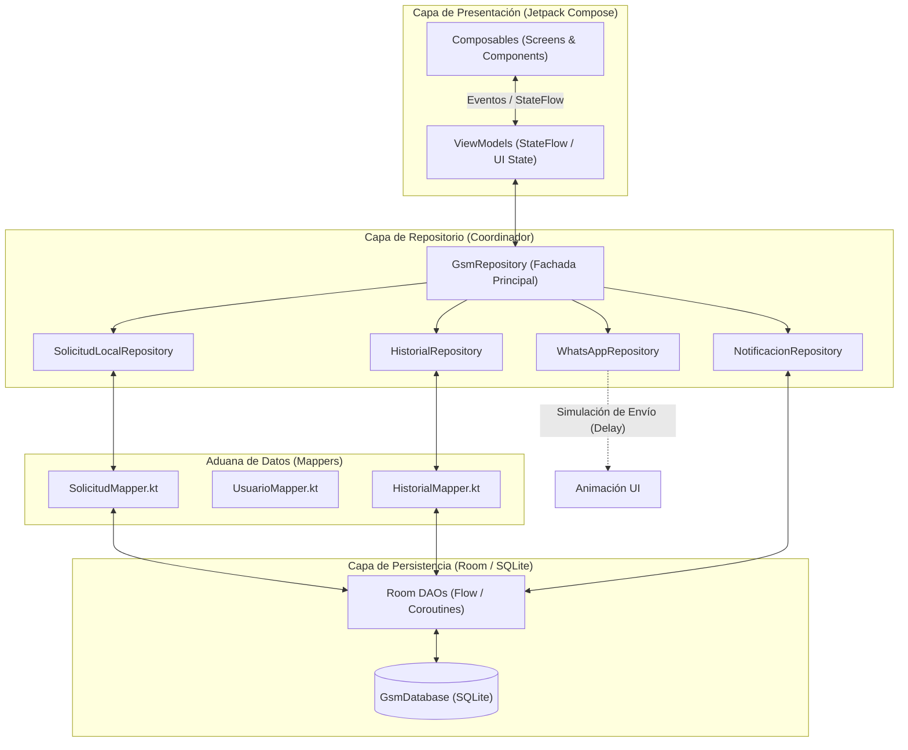
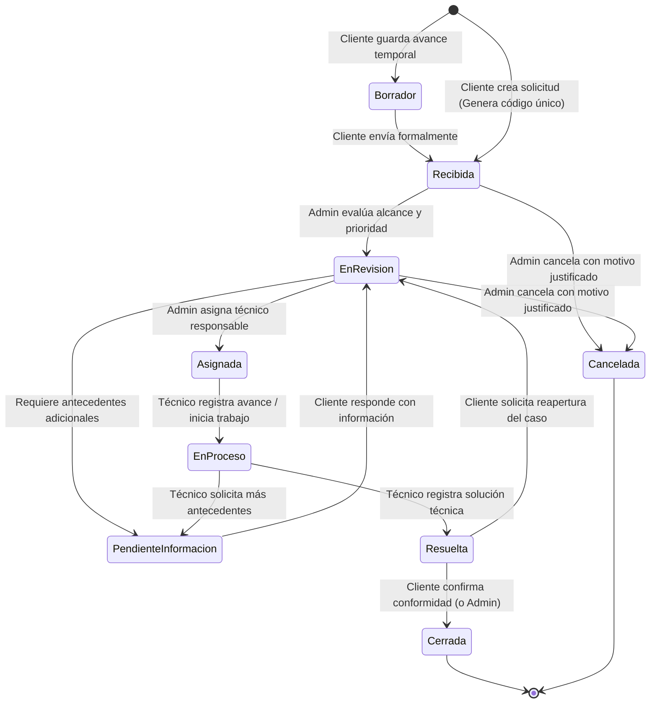
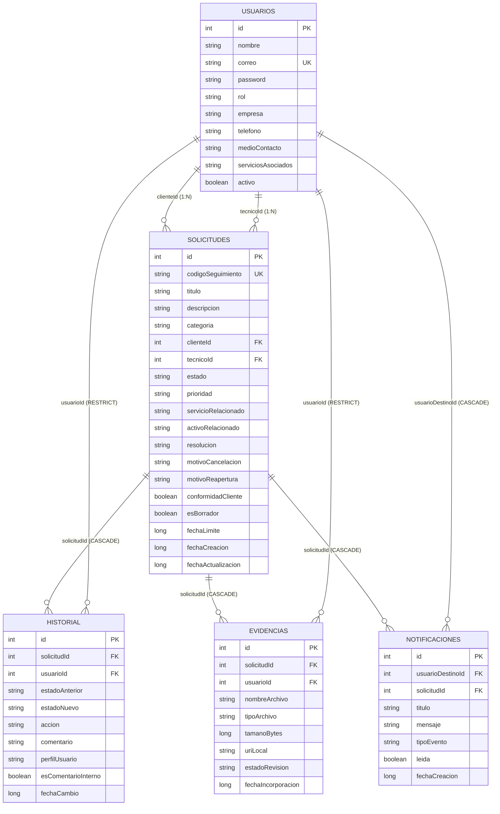

# GSM - Gestión Móvil y Seguimiento de Solicitudes de Clientes

[](https://kotlinlang.org/)
[](https://developer.android.com/)
[](https://developer.android.com/jetpack/compose)
[-F58220.svg?logo=sqlite&logoColor=white)](https://developer.android.com/training/data-storage/room)
[](https://developer.android.com/topic/architecture)
[](https://www.duoc.cl/)

---

## 📌 1. Descripción del Proyecto

**GSM (Gestión de Solicitudes Móviles)** es una aplicación Android nativa diseñada para resolver la problemática operativa de trazabilidad, coordinación y seguimiento de requerimientos técnicos en una pequeña empresa de servicios informáticos y digitales (desarrollo web, hosting, soporte técnico y marketing digital).

El desafío aborda el problema recurrente en el que los clientes envían solicitudes a través de **WhatsApp** (texto, audios, documentos o imágenes), provocando que los requerimientos se pierdan en chats informales, carezcan de identificador único, no cuenten con prioridad asignada ni responsable explícito, y no tengan un cierre formal ni evidencia registrada.

GSM permite capturar estas solicitudes, asignarles un código alfanumérico único para derivación por WhatsApp, controlar el flujo de trabajo de atención por perfiles de usuario, auditar cada cambio en un historial cronológico y supervisar el avance mediante métricas administrativas.

> **Contexto Académico:** Proyecto semestral para la asignatura **DSY1105 - Desarrollo de Aplicaciones Móviles**, Escuela de Informática y Telecomunicaciones, CITT Puente Alto, Duoc UC.

---

## 🚦 2. Estado de Avance y Hoja de Ruta

| Fase | Módulo / Componente | Estado | Detalle |
| :--- | :--- | :---: | :--- |
| **Fase 1** | **Persistencia y Modelado Room** | 🟢 **100% Completado** | 5 entidades relacionales (`Usuario`, `Solicitud`, `Historial`, `Evidencia`, `Notificacion`), llaves foráneas, índices de búsqueda y 5 DAOs con `Flow`. |
| **Fase 2** | **Capa de Transformación (Mappers)** | 🟢 **100% Completado** | Aislamiento estricto de MVVM mediante `SolicitudMapper`, `UsuarioMapper` e `HistorialMapper` protegidos con `runCatching`. |
| **Fase 3** | **Capa de Repositorios y Negocio** | 🟢 **90% Completado** | Arquitectura Fachada/Coordinador con `GsmRepository` y 4 sub-repositorios (`SolicitudLocal`, `Historial`, `Notificacion`, `WhatsApp`). |
| **Fase 4** | **Capa ViewModel (Lógica de Presentación)** | ⚪ **Próxima Etapa** | `AuthViewModel`, `SolicitudViewModel`, `DetalleSolicitudViewModel` y `AdminDashboardViewModel`. |
| **Fase 5** | **Interfaz de Usuario (Jetpack Compose)** | ⚪ **Pendiente** | Implementación de pantallas con Material 3, navegación por roles y animación de envío simulado de WhatsApp. |
| **Fase 6** | **QA y Entrega Final** | ⚪ **Pendiente** | Validación de los 40 criterios de éxito del caso y generación de APK firmado en modo release. |

---

## 🏗️ 3. Arquitectura del Software (MVVM + Clean Boundaries)

El proyecto implementa la arquitectura recomendada por Google: **MVVM (Model-View-ViewModel)** con flujo unidireccional de datos (UDF), enriquecida con **Mappers de Dominio** para aislar la base de datos de la interfaz de usuario:



### Stack Tecnológico:
* **Lenguaje:** Kotlin 2.0+
* **Plataforma:** Android Nativo (Min SDK: 33 / Android 13, Target SDK: 37)
* **UI Toolkit:** Jetpack Compose (BOM) + Material Design 3
* **Persistencia:** Room Database 2.6+ con KSP (Kotlin Symbol Processing)
* **Concurrencia:** Kotlin Coroutines & Asynchronous Flows
* **Gestor de Dependencias:** Gradle con Version Catalogs (`libs.versions.toml`)

---

## 👥 4. Matriz de Perfiles y Control de Acceso (RBAC)

El sistema opera con tres perfiles de usuarios de prueba (datos ficticios):

| Perfil | Responsabilidades Principales | Restricciones Estrictas de Seguridad |
| :--- | :--- | :--- |
| **👤 Cliente** | • Registrar nueva solicitud con categoría y adjuntos ficticios.<br>• Guardar solicitudes temporales (borradores).<br>• Obtener código de seguimiento único (`SOL-YYYY-XXXX`).<br>• Compartir mensaje estructurado por WhatsApp.<br>• Consultar historial y última actualización.<br>• Confirmar conformidad o solicitar reapertura. | ❌ No puede ver solicitudes de otros clientes.<br>❌ No puede asignar técnicos ni modificar prioridades.<br>❌ No puede ver comentarios marcados como internos.<br>❌ No puede forzar cierre sin flujo previo. |
| **👔 Administrador / Coordinador** | • Consultar todas las solicitudes autorizadas.<br>• Clasificar requerimientos y establecer prioridad.<br>• Asignar y reasignar técnicos responsables.<br>• Detectar solicitudes atrasadas y pendientes de información.<br>• Visualizar dashboard general de métricas.<br>• Cerrar o cancelar solicitudes con motivo. | ❌ Todo cambio de estado, prioridad o asignación debe dejar registro inmutable en el historial. |
| **🔧 Técnico / Ejecutor** | • Consultar su bandeja personal de solicitudes asignadas.<br>• Revisar antecedentes y archivos adjuntos.<br>• Registrar avances y comentarios de trabajo.<br>• Solicitar información adicional al cliente.<br>• Registrar solución técnica y marcar como resuelta. | ❌ No puede consultar solicitudes de otros técnicos sin autorización.<br>❌ No puede alterar datos del cliente.<br>❌ No puede cerrar definitivamente sin confirmación de conformidad. |

---

## 🔄 5. Ciclo de Vida de una Solicitud

Toda transición de estado es auditada de forma atómica en `HistorialEntity`:



---

## 💾 6. Modelo de Datos Relacional (Room Schema)



---

## 📂 7. Estructura del Código Fuente

```text
GSM/
├── app/
│   ├── build.gradle.kts                   # Configuración de dependencias Android y KSP
│   └── src/
│       ├── main/
│       │   ├── AndroidManifest.xml
│       │   ├── java/com/example/gsm/
│       │   │   ├── MainActivity.kt        # Actividad principal (Compose Entrypoint)
│       │   │   ├── model/                 # Modelos de Dominio y Enums puros
│       │   │   │   ├── CategoriaSolicitud.kt
│       │   │   │   ├── EstadoSolicitud.kt
│       │   │   │   ├── PrioridadSolicitud.kt
│       │   │   │   ├── RolUsuario.kt
│       │   │   │   ├── Solicitud.kt
│       │   │   │   ├── Usuario.kt
│       │   │   │   ├── Historial.kt
│       │   │   │   └── SolicitudModels.kt # DTOs relacionales (@Relation)
│       │   │   ├── data/
│       │   │   │   ├── local/             # Persistencia local con Room
│       │   │   │   │   ├── GsmDatabase.kt
│       │   │   │   │   ├── dao/           # Data Access Objects (Flows reactivos)
│       │   │   │   │   │   ├── SolicitudDao.kt
│       │   │   │   │   │   ├── UsuarioDao.kt
│       │   │   │   │   │   ├── HistorialDao.kt
│       │   │   │   │   │   ├── EvidenciaDao.kt
│       │   │   │   │   │   └── NotificacionDao.kt
│       │   │   │   │   └── entity/        # Entidades mapeadas a SQLite
│       │   │   │   │       ├── SolicitudEntity.kt
│       │   │   │   │       ├── UsuarioEntity.kt
│       │   │   │   │       ├── HistorialEntity.kt
│       │   │   │   │       ├── EvidenciaEntity.kt
│       │   │   │   │       └── NotificacionEntity.kt
│       │   │   │   ├── mapper/            # Mappers de aislamiento MVVM
│       │   │   │   │   ├── SolicitudMapper.kt
│       │   │   │   │   ├── UsuarioMapper.kt
│       │   │   │   │   └── HistorialMapper.kt
│       │   │   │   └── repository/        # Repositorios (Patrón Fachada / Coordinador)
│       │   │   │       ├── GsmRepository.kt            # Coordinador principal
│       │   │   │       ├── SolicitudLocalRepository.kt # Operaciones de solicitudes
│       │   │   │       ├── HistorialRepository.kt      # Auditoría y privacidad
│       │   │   │       ├── NotificacionRepository.kt   # Alertas locales
│       │   │   │       └── WhatsAppRepository.kt       # Formato y simulación
│       │   │   └── ui/
│       │   │       ├── theme/             # Material 3 ColorScheme, Tipografía y Tema
│       │   │       ├── view/              # Pantallas y componentes Compose
│       │   │       └── viewmodel/         # ViewModels (Lógica de Presentación)
│       │   └── res/                       # Recursos XML, Drawables, Mipmaps
│       └── test/                          # Pruebas unitarias
├── gradle/
│   └── libs.versions.toml                 # Version Catalog centralizado
├── build.gradle.kts                       # Configuración de compilación raíz
├── gradle.properties                      # Ajustes de JVM y flags de compilación
└── README.md                              # Documentación técnica del proyecto
```

---

## 📲 8. Integración y Simulación con WhatsApp

Conforme a las restricciones académicas de las Secciones 3.4 y 5.1 del documento de caso:
* **Fuera de alcance:** No se utilizan APIs de pago (WhatsApp Business Platform), credenciales reales, scraping ni lectura de datos privados.
* **Mensaje Estructurado Oficial:** `WhatsAppRepository` construye el texto predefinido listo para compartir:
  ```text
  🔔 *SOLICITUD DE ASISTENCIA GSM*
  ----------------------------------
  📌 *Código:* SOL-2026-4821
  📝 *Título:* Caída en servidor de base de datos
  🏷️ *Categoría:* Incidente técnico
  👤 *Cliente:* Pyme Soluciones Alfa
  ⚡ *Prioridad:* ALTA
  ----------------------------------
  🔗 Puedes seguir el estado en la app GSM con tu código.
  ```
* **Simulación Asíncrona (Feedback UI):** Se implementa una simulación controlada de red (`simularEnvio`) que genera un retardo asíncrono para que la interfaz muestre una animación de confirmación ("Enviado a WhatsApp").

---

## 🚀 9. Requisitos de Ejecución y Entorno de Desarrollo

1. **Android Studio:** Ladybug (2024.2+) o posterior.
2. **JDK:** Java Development Kit 11 o 17 (JBR de Android Studio soportado).
3. **Dispositivo / Emulador:**
   * Android 13.0 (API 33) o superior.
   * Arquitectura x86_64 o ARM64.
4. **Compilación en consola:**
   ```bash
   ./gradlew assembleDebug
   ```

---

## 📋 10. Checklist de Criterios de Éxito del Caso (40 Criterios)

* [x] **C01 - C07:** Creación de solicitud con título, descripción, categoría, evidencia ficticia, ID único (`SOL-YYYY-XXXX`), timestamp y estado "Recibida".
* [x] **C08:** Generador de mensaje estructurado con código y referencia de seguimiento.
* [x] **C09 - C11:** Consulta de estado vigente, última actualización e historial cronológico.
* [x] **C12 - C16:** Clasificación administrativa, asignación de responsable, prioridad y auditoría en historial.
* [x] **C17 - C21:** Bandeja de solicitudes asignadas para técnicos, registro de avances, comentarios y fecha/hora.
* [x] **C22 - C27:** Identificación de solicitudes pendientes de información, atrasadas (cálculo de SLA) y filtros combinados.
* [x] **C28 - C30:** Sistema de notificaciones locales y métricas administrativas cuantitativas consistentes con Room.
* [x] **C31 - C34:** Registro de solución técnica, confirmación de conformidad, solicitud de reapertura y auditoría de cierre.
* [x] **C35 - C40:** Funcionamiento 100% offline-first con Room, control de acceso por roles y datos ficticios.

---

## 👨‍💻 Créditos y Autoría
* **Proyecto:** GSM - Gestión Móvil y Seguimiento de Solicitudes de Clientes
* **Sede:** Duoc UC Puente Alto - CITT
* **Asignatura:** DSY1105 - Desarrollo de Aplicaciones Móviles
