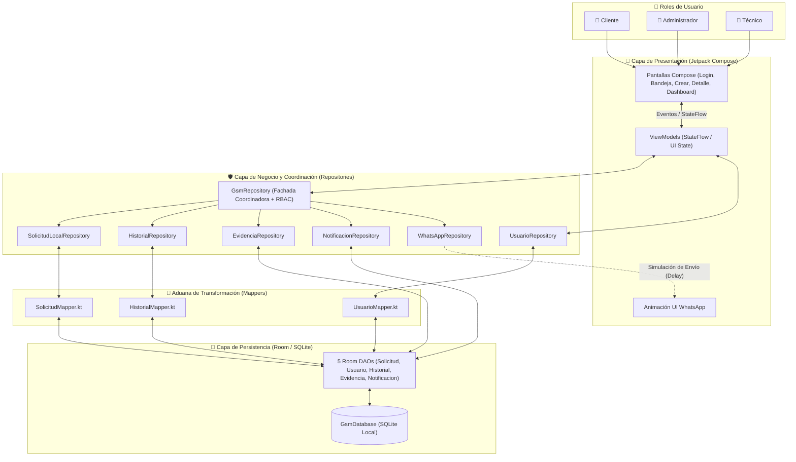
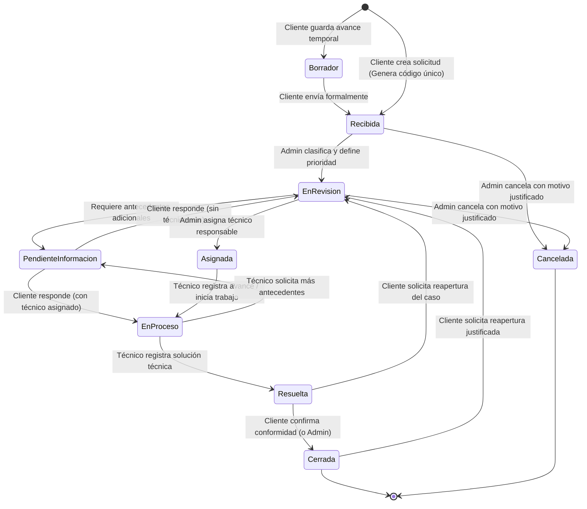
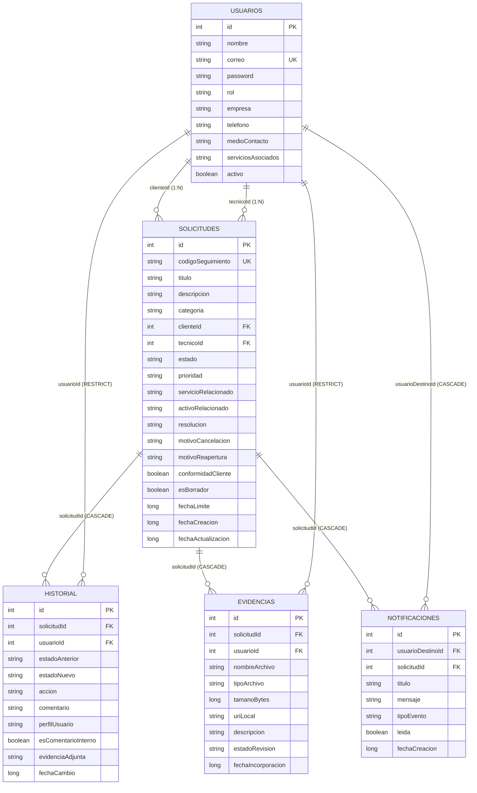

# 📱 GSM - Gestión Móvil y Seguimiento de Solicitudes de Clientes

[](https://kotlinlang.org/)
[](https://developer.android.com/)
[](https://developer.android.com/jetpack/compose)
[-F58220.svg?logo=sqlite&logoColor=white)](https://developer.android.com/training/data-storage/room)
[](https://developer.android.com/topic/architecture)
[](https://www.duoc.cl/)

---

## 📖 1. ¿De qué trata este proyecto? (Contexto del Caso)

**GSM (Gestión de Solicitudes Móviles)** es una aplicación Android nativa diseñada para resolver la problemática operativa de trazabilidad, coordinación y seguimiento de requerimientos técnicos en una pequeña empresa de servicios informáticos y digitales (desarrollo web, hosting, soporte técnico y marketing digital).

### El Problema que Resuelve
Actualmente, los clientes envían sus solicitudes por **WhatsApp** (mensajes de texto, audios, imágenes o documentos). Esto provoca que los requerimientos:
* Se pierdan en conversaciones largas.
* No tengan un **código único de seguimiento** (`SOL-YYYY-XXXX`).
* No tengan **prioridad**, **fecha límite (SLA)** ni **técnico responsable** explícito.
* No registren evidencia formal ni un cierre confirmado por el cliente.

### La Solución GSM
GSM centraliza todo el ciclo de vida de una solicitud desde su creación hasta su cierre formal, generando un mensaje estructurado listo para compartir en WhatsApp, separando permisos por rol (**Cliente**, **Administrador** y **Técnico**), auditando cada cambio en un historial inmutable y mostrando métricas en tiempo real sin depender de internet (100% *Offline-First* con SQLite/Room).

> **Contexto Académico:** Proyecto semestral para la asignatura **DSY1105 - Desarrollo de Aplicaciones Móviles**, Escuela de Informática y Telecomunicaciones, CITT Puente Alto, Duoc UC.

---

## 🎓 2. Guía para Estudiantes de 1er Año (Cómo entender el código desde cero)

Si estás empezando a programar en Android y Kotlin o no recuerdas qué hace cada carpeta, imagina que esta aplicación funciona como un **Restaurante bien organizado**:

```text
┌──────────────────────────────────────────────────────────────────────────────┐
│ 1. ENTITY (Carpeta: data/local/entity) ──► "LAS CAJAS EN LA BODEGA"          │
│    Son las tablas de la base de datos SQLite. Guardan los datos en la        │
│    memoria del teléfono para que NO se borren cuando cierras la aplicación.  │
├──────────────────────────────────────────────────────────────────────────────┤
│ 2. DAO (Carpeta: data/local/dao) ──► "EL BODEGUERO"                          │
│    Contiene las consultas SQL (@Query SELECT, @Insert, @Update) para         │
│    guardar, buscar o filtrar datos dentro de la base de datos Room.          │
├──────────────────────────────────────────────────────────────────────────────┤
│ 3. MODEL (Carpeta: model/) ──► "EL PLATO LIMPIO PARA SERVIR"                 │
│    Son las clases limpias de Kotlin (Solicitud, Usuario, Historial) que      │
│    viajan hacia las pantallas, sin anotaciones complejas de base de datos.   │
├──────────────────────────────────────────────────────────────────────────────┤
│ 4. MAPPER (Carpeta: data/mapper) ──► "EL TRADUCTOR / ADUANA"                 │
│    Convierte una "Caja de bodega" (Entity) en un "Plato limpio" (Model)      │
│    usando `.toDomain()`, y viceversa usando `.toEntity()`.                   │
├──────────────────────────────────────────────────────────────────────────────┤
│ 5. REPOSITORY (Carpeta: data/repository) ──► "EL JEFE DE COCINA"             │
│    Aquí viven las reglas del negocio y la seguridad. Ejemplo: cuando el      │
│    Admin asigna un técnico, el repositorio actualiza la solicitud, anota     │
│    en el historial y envía una notificación en un solo paso coordinado.      │
├──────────────────────────────────────────────────────────────────────────────┤
│ 6. VIEWMODEL (Carpeta: ui/viewmodel) ──► "EL MESERO"                         │
│    Conecta la cocina (Repository) con las mesas (Pantallas). Mantiene el     │
│    estado de la pantalla vivo incluso si el usuario gira el teléfono.        │
├──────────────────────────────────────────────────────────────────────────────┤
│ 7. COMPOSE UI (Carpeta: ui/view) ──► "EL MENÚ Y LAS MESAS"                   │
│    Son las pantallas visuales (botones, tarjetas, formularios y colores)     │
│    construidas con Jetpack Compose y Material Design 3.                      │
└──────────────────────────────────────────────────────────────────────────────┘
```

### 💡 4 Conceptos de Kotlin que verás en el código:
1. **`suspend fun` (Función Suspendida):** Es una operación que puede tardar unos milisegundos (como escribir en la base de datos o simular red) y se ejecuta en segundo plano (Corrutinas) para que **la pantalla nunca se congele**.
2. **`Flow<List<Solicitud>>` (Tubería en Vivo):** A diferencia de una lista normal que pides una sola vez, un `Flow` queda escuchando la base de datos. Si alguien cambia el estado de una solicitud, **la pantalla se actualiza sola automáticamente**.
3. **`Result<T>` y `runCatching { ... }`:** Es una caja de seguridad. Si todo sale bien devuelve `Result.success(dato)`, y si algo falla (por ejemplo, un usuario sin permisos) devuelve `Result.failure(error)` sin que la aplicación se cierre sola (*crash*).
4. **`require(condicion) { "Mensaje de error" }`:** Es un guardia de seguridad en la entrada de una función. Si la condición no se cumple (ej. un Cliente intentando asignar un técnico), detiene la operación de inmediato y devuelve el mensaje explicativo.

---

## 📊 3. Estado Actual de Ingeniería (Barra de Progreso)

```text
╔══════════════════════════════════════════════════════════════════════════════╗
║                    ESTADO ACTUAL DE INGENIERÍA - PROYECTO GSM                ║
╠══════════════════════════════════════════════════════════════════════════════╣
║                                                                              ║
║  FASE 1: Base de Datos (Entities + DAOs)   [██████████] 100% COMPLETADO ✅   ║
║  FASE 2: Traductores (Mappers)             [██████████] 100% COMPLETADO ✅   ║
║  FASE 3: Repositorios y Reglas OWASP       [██████████] 100% COMPLETADO ✅   ║
║  ──────────────────────────────────────────────────────────────────────────  ║
║  PASO PUENTE: Semilla de Datos en Room     [░░░░░░░░░░]   0% <-- SIGUIENTE 📍║
║  FASE 4: ViewModels (Cerebro de Pantallas) [░░░░░░░░░░]   0% PENDIENTE ⏳    ║
║  FASE 5: Pantallas (Jetpack Compose UI)    [░░░░░░░░░░]   0% PENDIENTE ⏳    ║
║  FASE 6: Pruebas Unitarias y APK Final     [░░░░░░░░░░]   0% PENDIENTE ⏳    ║
║                                                                              ║
╚══════════════════════════════════════════════════════════════════════════════╝
```

| Fase | Módulo / Componente | Estado | Detalle de Implementación |
| :--- | :--- | :---: | :--- |
| **Fase 1** | **Persistencia y Modelado Room** | 🟢 **100% Completado** | 5 entidades relacionales (`Usuario`, `Solicitud`, `Historial`, `Evidencia`, `Notificacion`), llaves foráneas, índices de búsqueda y 5 DAOs reactivos con `Flow`. |
| **Fase 2** | **Capa de Transformación (Mappers)** | 🟢 **100% Completado** | Aislamiento estricto de MVVM mediante `SolicitudMapper`, `UsuarioMapper` e `HistorialMapper` protegidos con `runCatching`. |
| **Fase 3** | **Capa de Repositorios y Seguridad** | 🟢 **100% Completado** | Fachada coordinadora `GsmRepository` + 5 sub-repositorios (`SolicitudLocal`, `Usuario`, `Historial`, `Evidencia`, `Notificacion`, `WhatsApp`) con validaciones OWASP y RBAC. |
| **Fase 4** | **Datos Semilla + Capa ViewModel** | 🟡 **Próxima Etapa** | Precarga automática en `GsmDatabase` + `AuthViewModel` y `GsmViewModel` con `StateFlow`. |
| **Fase 5** | **Interfaz de Usuario (Jetpack Compose)** | ⏳ **Pendiente** | 5 pantallas Material 3, navegación por roles y animación de envío simulado de WhatsApp. |
| **Fase 6** | **QA, Pruebas Unitarias y Entrega Final** | ⏳ **Pendiente** | Pruebas unitarias en `ExampleUnitTest.kt`, validación de los 40 criterios del PDF y APK firmado en modo release. |

---

## 🏗️ 4. Arquitectura y Gráficos de Flujo de Comunicación

### 4.1 Flujo de un Clic a través de las Capas (MVVM Paso a Paso)

```text
  👤 USUARIO (Toca un botón en la pantalla, ej: "Crear Solicitud")
      │
      ▼
┌─────────────────────────────────────────────────────────┐
│ 📱 PANTALLA COMPOSE (ui/view)                           │
│    Llama al ViewModel: viewModel.crearSolicitud(...)    │
└─────────────────────────────────────────────────────────┘
      │
      ▼
┌─────────────────────────────────────────────────────────┐
│ 🧠 VIEWMODEL (ui/viewmodel)                             │
│    Abre corrutina (segundo plano) y llama a:            │
│    gsmRepository.crearSolicitud(...)                    │
└─────────────────────────────────────────────────────────┘
      │
      ▼
┌─────────────────────────────────────────────────────────┐
│ 🛡️ GSM REPOSITORY (data/repository/GsmRepository.kt)    │
│    1. Revisa seguridad RBAC (¿Tiene permiso este rol?)  │
│    2. Genera código único (SOL-2026-XXXX)               │
│    3. Calcula fecha límite según prioridad (SLA)        │
│    4. Coordina: Solicitud + Evidencia + Historial       │
└─────────────────────────────────────────────────────────┘
      │
      ▼
┌─────────────────────────────────────────────────────────┐
│ 🔄 MAPPER + 💾 DAO (data/mapper y data/local/dao)       │
│    Convierte a Entity (.toEntity) y hace INSERT en SQL  │
└─────────────────────────────────────────────────────────┘
      │
      ▼
  ✨ LA TUBERÍA (Flow) AVISA A LA PANTALLA Y SE REDIBUJA SOLA
```

### 4.2 Mapa General de Comunicación entre Componentes (Mermaid)



### 4.3 Flujo de Negocio Completo entre los 3 Roles

```text
  [ 👤 CLIENTE ]                  [ 👔 ADMINISTRADOR ]             [ 🔧 TÉCNICO ]
        │                                  │                             │
  1. Inicia sesión                         │                             │
  2. Crea Solicitud                        │                             │
     (Título, Categoría,                   │                             │
      Evidencia ficticia)                  │                             │
        │                                  │                             │
        ▼                                  │                             │
  Estado: [RECIBIDA]                       │                             │
  Genera: SOL-2026-XXXX                    │                             │
  Comparte a WhatsApp 📲                   │                             │
        │                                  │                             │
        └─────────────────────────► 3. Ve solicitud nueva                │
                                    4. Clasifica y da Prioridad          │
                                       Estado: [EN_REVISION]             │
                                    5. ¿Faltan datos?                    │
                                       ├── SÍ ──► [PENDIENTE_INFO]       │
                                       │          (Cliente responde)     │
                                       ▼                                 │
                                    6. Asigna un Técnico                 │
                                       Estado: [ASIGNADA]                │
                                       │                                 │
                                       └────────────────────────► 7. Ve su bandeja
                                                                  8. Registra avance
                                                                     Estado: [EN_PROCESO]
                                                                  9. Registra solución
                                                                     Estado: [RESUELTA]
                                                                         │
  10. Recibe aviso ◄─────────────────────────────────────────────────────┘
      ¿Está conforme?
      ├── SÍ ──► Confirma cierre ──► Estado: [CERRADA] ✅ (Fin del flujo)
      └── NO ──► Pide reapertura ──► Vuelve a [EN_REVISION] 🔄
```

### 4.4 Diagrama de Estados Oficial (Ciclo de Vida de una Solicitud)



---

## 🛡️ 5. Principios SOLID y Seguridad OWASP Aplicados

El proyecto fue auditado bajo principios de ingeniería de software limpia (**SOLID + KISS**) y protección contra vulnerabilidades (**OWASP Mobile Top 10**), cumpliendo las restricciones de las páginas 6, 8, 15 y 16 del documento del caso:

### 5.1 Principios SOLID en el Proyecto
* **S — Single Responsibility Principle (Responsabilidad Única):** Cada sub-repositorio tiene una única razón para cambiar:
  * `SolicitudLocalRepository`: Solo CRUD de solicitudes, generación de código `SOL-YYYY-XXXX` y cálculo de SLA.
  * `HistorialRepository`: Solo bitácora de auditoría y filtro de privacidad para ocultar comentarios internos al cliente.
  * `EvidenciaRepository`: Solo validación y registro de archivos adjuntos ficticios.
  * `NotificacionRepository`: Solo alertas locales por cambios de estado.
  * `WhatsAppRepository`: Solo formato de texto estructurado y simulación de envío.
  * `GsmRepository`: Fachada coordinadora que une los pasos anteriores de forma atómica.
* **O — Open/Closed Principle (Abierto/Cerrado):** El uso de `enum class` (`CategoriaSolicitud`, `EstadoSolicitud`, `PrioridadSolicitud`, `RolUsuario`) permite extender comportamientos sin alterar la estructura de base de datos.
* **D — Dependency Inversion Principle (Inversión de Dependencias):** Los repositorios reciben sus DAOs por constructor en lugar de instanciarlos internamente, facilitando las pruebas unitarias.

### 5.2 Seguridad OWASP y Matriz de Control de Acceso (RBAC)
1. **Prevención de Control de Acceso Roto (OWASP M1 / A01):**
   `GsmRepository` valida mediante cláusulas de guarda (`require(...)`) el rol del usuario y el estado previo antes de tocar la base de datos:
   * ❌ Un `CLIENTE` no puede clasificar, cambiar prioridad, asignar técnicos, registrar avances técnicos ni cancelar solicitudes.
   * ❌ Un `CLIENTE` no puede modificar ni cerrar solicitudes de otro cliente (`solicitud.clienteId == usuario.id`).
   * ❌ Un `CLIENTE` no puede ver comentarios marcados como `esComentarioInterno = true` (`HistorialRepository` los filtra desde SQLite).
   * ❌ Un `TECNICO` no puede cerrar definitivamente una solicitud sin confirmación de conformidad.
   * ❌ Ninguna solicitud puede pasar a `CERRADA` si no está previamente en estado `RESUELTA`.
2. **Validación de Entradas y Archivos Adjuntos (OWASP M4 — Pág. 16 del PDF):**
   `EvidenciaRepository` restringe estrictamente los archivos de prueba:
   * **Formatos permitidos:** `image/jpeg`, `image/png`, `application/pdf`, `text/plain`.
   * **Tamaño máximo:** Límite estricto de **5 MB** (`5 * 1024 * 1024 bytes`).
3. **Privacidad de Datos (OWASP M2 / M9 — Págs. 13 y 15 del PDF):**
   * Uso exclusivo de cuentas, empresas y archivos sintéticos/ficticios.
   * El mensaje estructurado de WhatsApp incluye código, título, categoría y enlace ficticio de seguimiento (`https://gsm-soporte.cl/seguimiento/SOL-YYYY-XXXX`), sin exponer contraseñas, RUT ni conversaciones privadas.

---

## 🗂️ 6. Hoja de Ruta en Recuadros (Lo que falta para terminar el 100%)

```text
╔══════════════════════════════════════════════════════════════════════════════╗
║ 🟧 RECUADRO A: CONEXIÓN Y DATOS SEMILLA (Paso Puente)                        ║
╠══════════════════════════════════════════════════════════════════════════════╣
║                                                                              ║
║  📄 Archivo: data/local/GsmDatabase.kt                                       ║
║  🎯 ¿Para qué sirve?                                                         ║
║     1. Crea una única conexión a la base de datos (`getInstance`).           ║
║     2. Inserta automáticamente usuarios ficticios al abrir la app:           ║
║        • cliente@pyme.cl      (Rol: CLIENTE)                                 ║
║        • admin@gsm.cl         (Rol: ADMINISTRADOR)                           ║
║        • tecnico1@gsm.cl      (Rol: TECNICO)                                 ║
║        • tecnico2@gsm.cl      (Rol: TECNICO)                                 ║
║     3. Inserta 4 solicitudes de ejemplo (1 Recibida, 1 Atrasada,             ║
║        1 En Proceso, 1 Resuelta) para demostrar la app desde el minuto 1.    ║
║                                                                              ║
╚══════════════════════════════════════════════════════════════════════════════╝

╔══════════════════════════════════════════════════════════════════════════════╗
║ 🟨 RECUADRO B: FASE 4 - CAPA VIEWMODEL (El cerebro de las pantallas)         ║
╠══════════════════════════════════════════════════════════════════════════════╣
║                                                                              ║
║  En la carpeta `ui/viewmodel/` se implementarán 2 ViewModels simples:        ║
║                                                                              ║
║  📄 1. AuthViewModel.kt                                                      ║
║     • Guarda quién es el usuario conectado (`usuarioActual`).                ║
║     • Funciones `iniciarSesion(correo, password)` y `cerrarSesion()`.        ║
║     • Función `entrarComoDemo(rol)` para cambiar de perfil con 1 toque.      ║
║                                                                              ║
║  📄 2. GsmViewModel.kt                                                       ║
║     • Conecta con `GsmRepository` y `UsuarioRepository`.                     ║
║     • Entrega la bandeja de solicitudes filtrada por Rol, Estado, Prioridad, ║
║       Cliente, Técnico o Atrasadas.                                          ║
║     • Entrega el Detalle, Historial, Evidencias y Métricas del Dashboard.    ║
║     • Expone las funciones de negocio para los botones de cada perfil.       ║
║                                                                              ║
╚══════════════════════════════════════════════════════════════════════════════╝

╔══════════════════════════════════════════════════════════════════════════════╗
║ 🟦 RECUADRO C: FASE 5 - PANTALLAS EN JETPACK COMPOSE (Interfaz Material 3)   ║
╠══════════════════════════════════════════════════════════════════════════════╣
║                                                                              ║
║  En la carpeta `ui/view/` se construirán las 5 pantallas del flujo:          ║
║                                                                              ║
║  📄 1. LoginScreen.kt                                                        ║
║     • Login tradicional + 3 tarjetas de "Acceso Rápido Ficticio"             ║
║       (Cliente, Administrador, Técnico).                                     ║
║                                                                              ║
║  📄 2. BandejaScreen.kt                                                      ║
║     • Buscador por código (`SOL-2026-XXXX`), chips de filtro y tarjetas      ║
║       con diferenciación visual por color según el estado.                   ║
║                                                                              ║
║  📄 3. CrearSolicitudScreen.kt                                               ║
║     • Formulario de Título, Descripción, Categoría, Servicio y Evidencia     ║
║       ficticia + Botón "Guardar Borrador" y "Enviar Solicitud".              ║
║                                                                              ║
║  📄 4. DetalleSolicitudScreen.kt                                             ║
║     • Ficha completa + Botón de WhatsApp con animación de envío + Panel de   ║
║       acciones exclusivo según el Rol activo + Línea de tiempo del Historial.║
║                                                                              ║
║  📄 5. AdminDashboardScreen.kt                                               ║
║     • Panel de resumen administrativo con contadores en tiempo real.         ║
║                                                                              ║
║  📄 6. MainActivity.kt                                                       ║
║     • Punto de entrada que conecta la navegación entre las 5 pantallas.      ║
║                                                                              ║
╚══════════════════════════════════════════════════════════════════════════════╝

╔══════════════════════════════════════════════════════════════════════════════╗
║ 🟩 RECUADRO D: FASE 6 - PRUEBAS UNITARIAS Y APK RELEASE                      ║
╠══════════════════════════════════════════════════════════════════════════════╣
║                                                                              ║
║  📄 Archivo: app/src/test/java/com/example/gsm/ExampleUnitTest.kt            ║
║  🎯 ¿Qué valida?                                                             ║
║     • Test 1: Que `generarCodigoUnico()` cumpla el formato `SOL-YYYY-XXXX`.  ║
║     • Test 2: Que `calcularSlaFechaLimite()` calcule 6h, 24h, 72h y 168h.    ║
║     • Test 3: Que `crearMensajeEstructurado()` incluya código y seguimiento. ║
║     • Test 4: Que `EvidenciaRepository` rechace archivos > 5 MB o inválidos. ║
║                                                                              ║
╚══════════════════════════════════════════════════════════════════════════════╝
```

---

## 💾 7. Modelo de Datos Relacional (Room Schema)



---

## 📂 8. Estructura del Código Fuente

```text
GSM/
├── app/
│   ├── build.gradle.kts                   # Configuración de dependencias Android, Compose y KSP
│   └── src/
│       ├── main/
│       │   ├── AndroidManifest.xml
│       │   ├── java/com/example/gsm/
│       │   │   ├── MainActivity.kt        # Actividad principal (Compose Entrypoint)
│       │   │   ├── model/                 # Modelos de Dominio y Enums puros ("El Plato Limpio")
│       │   │   │   ├── CategoriaSolicitud.kt
│       │   │   │   ├── EstadoSolicitud.kt
│       │   │   │   ├── PrioridadSolicitud.kt
│       │   │   │   ├── RolUsuario.kt
│       │   │   │   ├── Solicitud.kt
│       │   │   │   ├── Usuario.kt
│       │   │   │   ├── Historial.kt
│       │   │   │   └── SolicitudModels.kt # DTOs relacionales (@Relation)
│       │   │   ├── data/
│       │   │   │   ├── local/             # Persistencia local con Room ("La Bodega")
│       │   │   │   │   ├── GsmDatabase.kt
│       │   │   │   │   ├── dao/           # Data Access Objects ("El Bodeguero")
│       │   │   │   │   │   ├── SolicitudDao.kt
│       │   │   │   │   │   ├── UsuarioDao.kt
│       │   │   │   │   │   ├── HistorialDao.kt
│       │   │   │   │   │   ├── EvidenciaDao.kt
│       │   │   │   │   │   └── NotificacionDao.kt
│       │   │   │   │   └── entity/        # Entidades mapeadas a SQLite ("Las Cajas")
│       │   │   │   │       ├── SolicitudEntity.kt
│       │   │   │   │       ├── UsuarioEntity.kt
│       │   │   │   │       ├── HistorialEntity.kt
│       │   │   │   │       ├── EvidenciaEntity.kt
│       │   │   │   │       └── NotificacionEntity.kt
│       │   │   │   ├── mapper/            # Mappers de aislamiento MVVM ("El Traductor")
│       │   │   │   │   ├── SolicitudMapper.kt
│       │   │   │   │   ├── UsuarioMapper.kt
│       │   │   │   │   └── HistorialMapper.kt
│       │   │   │   └── repository/        # Repositorios ("El Jefe de Cocina")
│       │   │   │       ├── GsmRepository.kt            # Coordinador principal + RBAC
│       │   │   │       ├── SolicitudLocalRepository.kt # CRUD Solicitudes, Código y SLA
│       │   │   │       ├── UsuarioRepository.kt        # Autenticación y Perfiles
│       │   │   │       ├── HistorialRepository.kt      # Auditoría y privacidad
│       │   │   │       ├── EvidenciaRepository.kt      # Validación OWASP de adjuntos
│       │   │   │       ├── NotificacionRepository.kt   # Alertas locales
│       │   │   │       └── WhatsAppRepository.kt       # Formato estructurado y simulación
│       │   │   └── ui/
│       │   │       ├── theme/             # Material 3 ColorScheme, Tipografía y Tema
│       │   │       ├── view/              # Pantallas y componentes Compose (Fase 5)
│       │   │       └── viewmodel/         # ViewModels de Presentación (Fase 4)
│       │   └── res/                       # Recursos XML, Drawables, Mipmaps
│       └── test/                          # Pruebas unitarias (Fase 6)
├── gradle/
│   └── libs.versions.toml                 # Version Catalog centralizado
├── build.gradle.kts                       # Configuración de compilación raíz
└── README.md                              # Documentación maestra del proyecto
```

---

## 📲 9. Integración y Simulación con WhatsApp

Conforme a las secciones **3.4 y 5.1** del documento de caso:
* **Fuera de alcance:** No se utilizan APIs de pago (WhatsApp Business Platform), credenciales reales, lectura de chats reales ni datos personales.
* **Mensaje Estructurado Oficial (`WhatsAppRepository.kt`):**
  ```text
  🔔 *SOLICITUD DE ASISTENCIA GSM*
  ----------------------------------
  📌 *Código:* SOL-2026-4821
  📝 *Título:* Caída en servidor de base de datos
  🏷️ *Categoría:* Incidente técnico
  👤 *Cliente (Ficticio):* Pyme Soluciones Alfa
  ⚡ *Prioridad:* ALTA
  🔗 *Seguimiento:* https://gsm-soporte.cl/seguimiento/SOL-2026-4821
  ----------------------------------
  Puedes consultar el estado en la app GSM con tu código único.
  ```
* **Simulación Asíncrona (`simularEnvio`):** Genera un retardo controlado (`delay(1200L)`) para disparar una confirmación visual en la interfaz o compartir el texto mediante un `Intent` nativo de Android.

---

## 🚀 10. Requisitos de Ejecución y Compilación

1. **Android Studio:** Ladybug (2024.2+) o posterior.
2. **JDK:** Java Development Kit 11 o 17 (JBR incluido en Android Studio).
3. **Dispositivo / Emulador:** Android 13.0 (API 33) a Android 16+ (API 37).
4. **Compilar desde la terminal:**
   ```bash
   ./gradlew assembleDebug
   ```

---

## 📋 11. Checklist de los 40 Criterios de Éxito del Caso (Págs. 13 y 14 del PDF)

* [x] **01 - 06:** Creación de solicitud con título, descripción, categoría, evidencia ficticia, código único (`SOL-YYYY-XXXX`), fecha/hora y estado inicial `"RECIBIDA"`.
* [x] **07 - 08:** Mensaje estructurado para WhatsApp con código y referencia de seguimiento (`https://gsm-soporte.cl/seguimiento/...`).
* [x] **09 - 11:** Consulta de estado vigente, última actualización e historial cronológico filtrado por rol.
* [x] **12 - 16:** Consulta de solicitudes nuevas, clasificación administrativa, definición de prioridad, asignación de técnico y registro en historial.
* [x] **17 - 21:** Bandeja de solicitudes asignadas al técnico, registro de avances, comentarios (públicos e internos), actualización de estado y conservación de fecha/usuario.
* [x] **22 - 27:** Identificación de solicitudes pendientes de información y atrasadas (SLA) + filtros por estado, prioridad, cliente y responsable.
* [x] **28 - 30:** Notificaciones locales/simuladas y resumen administrativo por estado consistente con los registros almacenados en Room.
* [x] **31 - 34:** Registro de resolución técnica, confirmación de conformidad del cliente, solicitud de reapertura y registro del cierre en el historial.
* [x] **35 - 40:** Demostración 100% funcional sin depender de servidor remoto, restricción de acciones por perfil (RBAC), datos exclusivamente ficticios y sin credenciales reales de WhatsApp.

---

## 👨‍💻 Créditos y Autoría
* **Proyecto:** GSM - Gestión Móvil y Seguimiento de Solicitudes de Clientes
* **Sede:** Duoc UC Puente Alto - CITT
* **Asignatura:** DSY1105 - Desarrollo de Aplicaciones Móviles
