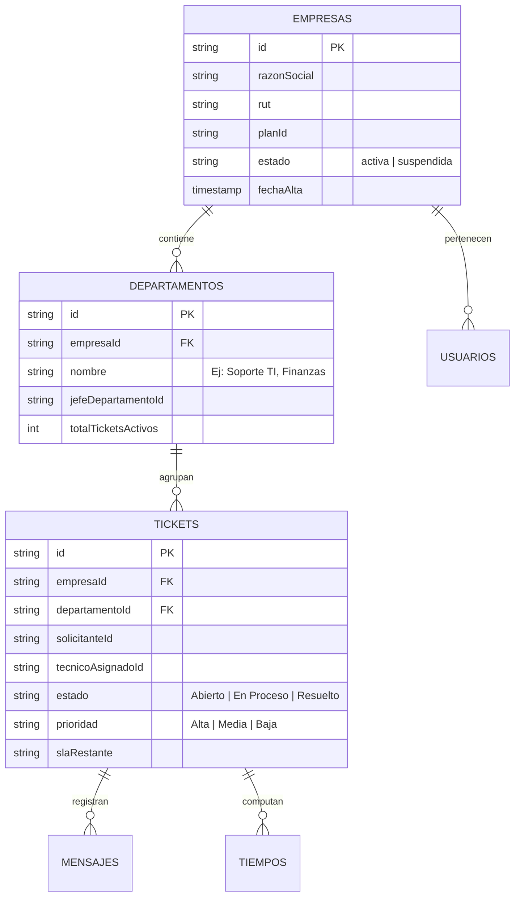

# Especificación de Diseño: AppShell Corporativo Estilo Teamwork.com para GSM-WEB

**Documento ID:** `EGM-SPEC-2026-001`  
**Estado:** Borrador listo para revisión  
**Autores:** Juan Varas & Elizabeth Reyes  
**Objetivo:** Transformar el área de trabajo interna de `GSM-WEB` (`/tickets`, `/empresas`, `/inbox`) adoptando el layout de alta densidad, navegación y jerarquía de **Teamwork.com** adaptado a la identidad de GSM.

---

## 1. Motivación y Visión

Los paneles actuales de la plataforma web presentan una visual clásica centrada únicamente en tickets individuales. Para lograr un producto a nivel de un SaaS corporativo publicable en LinkedIn, se implementa:
1. **Jerarquía Multi-Tenancy Empresarial:**
   - Cada **Empresa Cliente** (equivalente a *Projects* en Teamwork) agrupa múltiples **Departamentos** (TI, Finanzas, Operaciones, Marketing, etc.).
   - Los tickets y solicitudes pertenecen a un departamento específico dentro de una empresa.
2. **Layout Estilo Teamwork.com:**
   - **Header Superior Oscuro (`#0A0D14` / `#111827`):** Logo GSM, buscador omnibox con atajo `Ctrl + K`, notificaciones, temporizador y menú de perfil.
   - **Sidebar Izquierdo Claro (`#FFFFFF` con border `gray-200`):** Botón protagonista `+ Quick add`, secciones *Manage* (Empresas/Projects, Tickets, Clientes, Personas) y *Plan & Insights*.
   - **Subheader con Tabs Contextuales:** Pestañas estilo Teamwork (*Overview*, *Tasks/Tickets*, *Messages*, *Time*, *Files*, *People*).

---

## 2. Modelo de Datos y Entidades (Firestore)

---

## 3. Matriz de Visualización RBAC

| Componente / Vista | Cliente | Técnico | Administrador |
| :--- | :--- | :--- | :--- |
| **Buscador `Ctrl + K`** | Sus tickets y departamentos de su empresa | Todos los tickets asignados y empresas asignadas | Búsqueda global (usuarios, empresas, tickets) |
| **Menú `Projects` / Empresas** | **Solo ve su propia Empresa** y sus departamentos | Ve las empresas y departamentos que atiende | Ve, crea, edita y asigna todas las empresas |
| **Botón `+ Quick add`** | Crear Ticket en un departamento | Crear Ticket o registrar Nota Interna | Crear Empresa, Departamento, Usuario o Ticket |
| **Zona `Inbox` (Mensajería)** | Hilos y chat de sus tickets | Mensajes de clientes + Notas Técnicas Privadas | Auditoría completa y supervisión de chats |

---

## 4. Plan de Componentes a Implementar

1. `src/components/layout/AppShell.tsx`:
   - Shell maestro con contenedor `flex h-dvh overflow-hidden`.
   - Topbar oscura con `QuickCommandPalette` (`Ctrl + K`).
   - Sidebar retráctil con iconos `lucide-react`.
2. `src/components/workspaces/EmpresasListView.tsx`:
   - Tabla idéntica a la captura de Teamwork: columna *Name*, *Type (Plan SLA)*, *Client*, *Owner*, *Start date*, *Due date*.
   - Árbol lateral izquierdo con categorías y departamentos.
3. `src/components/workspaces/DepartamentosWidget.tsx`:
   - Selector y gestor de departamentos por empresa.
