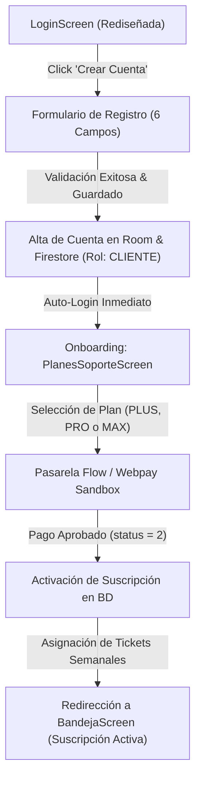

# Especificación de Diseño: Registro de Usuario, Rediseño de Login y Activación de Planes con Flow

## 1. Visión General
Este documento detalla la arquitectura técnica, la experiencia de usuario (UX) y el flujo de navegación para:
1. **Rediseño visual de `LoginScreen`**: Modernización con tipografía intencional, elevación sobria, branding oficial y conmutación limpia entre "Iniciar Sesión" y "Crear Cuenta".
2. **Formulario de Registro Corporativo**: Solicitud de los 6 campos exactos de la imagen adjunta por el usuario, exclusivo para clientes y empresas (`RolUsuario.CLIENTE`).
3. **Flujo de Onboarding Post-Registro**: Navegación automática a `PlanesSoporteScreen` tras el registro.
4. **Activación Automática de Suscripción con Flow**: Al confirmarse el pago exitoso en la pasarela Flow (Sandbox/Producción), se actualiza el plan, se asigna la cuota semanal de tickets correspondientes en Room y Firestore, y se redirige a la Bandeja principal con la cuenta activa.

---

## 2. Diagrama de Flujo (User Journey)



---

## 3. Especificación del Formulario de Registro (Campos Exactos de la Imagen)

El formulario contará con diseño de inputs limpios con bordes redondeados (12.dp), fondos claros y los iconos requeridos:

| Campo | Placeholder | Icono | Tipo de Teclado / Validación |
| :--- | :--- | :--- | :--- |
| **Nombre Completo \*** | `Ej: Matías González` | `Icons.Default.Person` | Texto capitalizado, mínimo 3 caracteres. |
| **Correo Electrónico Corporativo \*** | `contacto@miempresa.cl` | `Icons.Default.Email` | EmailAddress, validación de formato `@` y dominio. |
| **Empresa / Razón Social \*** | `Ej: Mi Empresa SpA` | `Icons.Default.Business` | Texto libre, identificador de la organización cliente. |
| **Teléfono de Contacto \*** | `+56 9 1234 5678` | `Icons.Default.Phone` | Phone, formato chileno (+569 o 9 dígitos). |
| **Contraseña \*** | `Mínimo 6 caracteres` | `Icons.Default.Lock` | Password con botón para alternar visibilidad (ojo). |
| **Confirmar Contraseña \*** | `Repite la contraseña` | `Icons.Default.Lock` | Debe coincidir exactamente con el campo anterior. |

> [!IMPORTANT]
> **Seguridad RBAC**: Esta pantalla registrará de forma inmutable el rol como `RolUsuario.CLIENTE`. Los roles técnicos y administrativos permanecen restringidos exclusivamente a la gestión interna del Administrador.

---

## 4. Modificaciones en Capas del Sistema

### 4.1 Modelo y Base de Datos (`Usuario` & Room)
Se asegura que la entidad `Usuario` contenga:
* `plan: String` (por defecto `"SIN_PLAN"` antes de pagar, luego `"PLUS"`, `"PRO"` o `"MAX"`).
* `ticketsDisponibles: Int` (0 al registrarse; 5 para PLUS, 25 para PRO, 999 para MAX).
* `estadoSuscripcion: String` (`"PENDIENTE_PAGO"`, `"ACTIVA"`, `"VENCIDA"`).
* `telefono: String` y `empresa: String`.

### 4.2 Lógica en `AuthViewModel`
* Nuevo método `registrarCliente(...)` que valida los 6 campos, invoca a `usuarioRepo.registrarCliente(...)` e inicia la sesión del nuevo usuario automáticamente.
* Estado `registroExitoso` para orquestar la navegación hacia la pantalla de planes.

### 4.3 `PlanesSoporteScreen` & Activación Flow
* Soporte para parámetro `esModoOnboarding: Boolean = false`.
* Al recibir la confirmación de pago aprobado desde `FlowPaymentRepository`:
  1. Se actualiza el usuario en Room y Firestore:
     ```kotlin
     usuarioRepo.actualizarPlanSuscripcion(
         usuarioId = usuario.id,
         nuevoPlan = plan.name,
         cuotaTickets = plan.ticketsPorSemana
     )
     ```
  2. Se actualiza el `usuarioActual` en `AuthViewModel`.
  3. Se emite un modal de celebración con resumen del plan adquirido.
  4. El botón "Comenzar a usar GSM" redirige a la Bandeja principal.

---

## 5. Decisiones de Diseño UI / Accesibilidad (UI Skills)
* **Contraste y legibilidad**: Fondos sobrios `#F8FAFC` y tarjetas elevadas `#FFFFFF` con borde suave `#E2E8F0`.
* **Micro-interacciones**: Transición suave mediante pestañas animadas (`Iniciar Sesión` / `Registrarse`).
* **Manejo defensivo de errores**: Indicadores visuales en rojo bajo cada campo si las contraseñas no coinciden o el correo es inválido antes de enviar la petición.

---

¿Deseas que procedamos con la implementación de este flujo de registro y activación según esta especificación?
